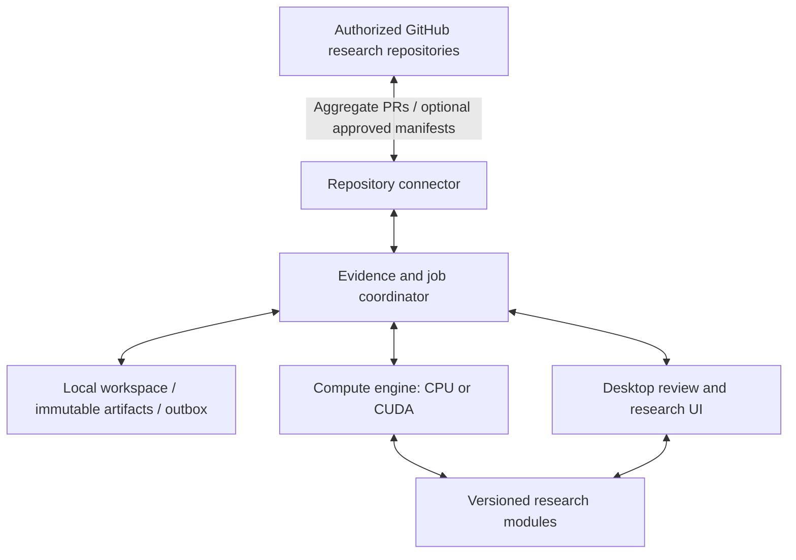

# Voynich Research Studio (VRS) — Product and engineering roadmap

**Proposed product name:** Voynich Research Studio (VRS) — Explore. Reproduce. Validate.
**Date:** 2026-11-25 | **Owner-directed planning revision** | **Baseline:** v0.8.1 / PR #93, head `cd1455caa0de793a0b5cbffdb609098cd908482e`.
**Status:** planned; no new implementation, release, scientific result, or merge is claimed by this document. Name is a working product decision, not trademark clearance.

## 1. Mission and scope

VRS is the local-first research and independent validation workbench of PROJECT VOYNICH, initially in DJCyberdog/voynich. EXP-0031–0037t supply structural and cross-transcription context; EXP-0038–0038g supply the immediate visual/semantic-anchor problem and EXP-0038g triggered the worker. The glyph pipeline is module 01, not the entire product. Later experiment families can add modules through explicit contracts. Research repositories remain the authorities for preregistration, approved jobs, scientific status and evidence; the application executes, reviews, reproduces and reports. Other repositories may participate only through explicit local authorization and a compatible contract.

Non-goals: autonomous decipherment claims, arbitrary remote code execution, a mandatory LLM, proprietary hosted coordination service, automatic main-branch writes/merges, uncontrolled training, public redistribution of private manuscripts or transcriptions, mandatory NVIDIA hardware, and replacing the project's scientific acceptance process. Do not invent future experiment results or reopen failed gates to improve metrics. K-0001 remains deferred until separately authorized.

### Owner-authorized post-1.0 module 03: codicology and multispectral investigation (2026-11-26)

Only after stable VRS 1.0 owner acceptance, extend the fixed local scope to the four planned packages VRS-150–170 (1.1.0–1.4.0), using the installed module SDK and existing coordinator, evidence, review and outbox contracts. After explicit local source/workspace/resource setup and module opt-in, execute the approved pipeline unattended, with human interaction only for unresolved evidence or independently assigned validation. Engineering implementation is authorized for the post-1.0 phase only; new scientific experiments and publication still require the existing preregistration/consent process. Use Yale RGB images and published 2014 MSI data where available (source leads: https://drive.google.com/drive/folders/1mNQGKQDSCR4M_c2M2JrsU5soghvYwMig and singulion study https://doi.org/10.4000/16k0a); verify access, provenance, licensing and actual coverage before ingestion. Missing data must remain explicitly missing. Physical contact is not proof of authorial order; no claim of complete reconstruction, material identification or decipherment. Preserve K-0001 deferral and previous findings. Work may proceed on independent engineering checkpoints when external evidence or native acceptance is blocked, without waiving gates.

### Owner requirement: automation-first, exception-only human interaction

VRS is first an unattended, locally configured manuscript-analysis worker; the UI is a control center and exception reviewer, not a mandatory manual annotation workflow. Its fixed owner-defined scope is manuscript-wide script/non-script detection, glyph segmentation/classification, comparison against loaded transcription inventories and existing transcriptions, controlled exception correction, evidence generation and reporting. After one-time local source/workspace/resource setup and opt-in startup/publication, VRS runs that established pipeline automatically without a GitHub job or per-run approval, selects an available backend, checkpoints and reports policy-approved aggregate evidence as PRs. GitHub is primarily an output/report destination; its existing opt-in job intake is an optional compatibility mechanism, not the normal execution prerequisite. No independent hypothesis generation, new EXP design, scientific roadmap changes, autonomous scope expansion or self-assigned research. A new research method or protocol change requires an explicit owner decision. Stop, pause, resource budgets, offline mode, publication disable and credential revocation remain under local control. No arbitrary remote code, direct main writes or automatic merges.

Routine glyph handling is **exception-only**: candidates passing a frozen, validated recognition/coverage/segmentation acceptance policy proceed without user interaction. Only unknown, low-confidence, out-of-distribution, unsupported inventory, ambiguous/compound segmentation or conflicting candidates requiring a human decision enter the ordinary review inbox. Recognized items are retained in evidence and accessible through optional inspection/history, never forced through the normal review queue. Uncalibrated confidence scores alone cannot certify recognition; until an independently validated acceptance policy exists, abstain conservatively rather than silently claiming certainty. Independent blind reference annotation and preregistered audit samples are separate scientific assignments, clearly identified, not routine recognition review; automated predictions never become their own ground truth.

The durable exception queue carries source/region hashes, candidate geometry, reason and uncertainty, per-convention reference inventory, dependency scope and immutable job/model version. Deduplicate retries without collapsing distinct source occurrences; handle separate reviewer assignments independently. The worker continues all unrelated work while a decision is pending. Dependent stages wait explicitly or report a partial/blocked result with complete denominators, and resume only on an authorized hash-bound decision or new approved revision. No hidden loss of unresolved cases; an empty queue is not proof of recognition accuracy.

A tray/status service runs optionally at user login only with explicit opt-in; headless mode is equally supported. Notifications show count and reason summary, are coalesced, respect cooldown/quiet hours and open directly to the next unresolved case. Do not steal focus or interrupt for successfully recognized glyphs. The normal UI may remain closed during processing. Auto-discover newly produced local review batches and approved transferred bundles within configured workspaces only; the prior v0.8.1 manually registered tray mode remains available. On user action, autosave atomically, advance to the next exception, and immediately make the decision available to the local coordinator/outbox. Offline decisions queue for authorized synchronization. Reviewer can map EVA/STA1/other catalogs separately, mark absent/unknown/false positive/compound/deferred, or propose revised boxes. No blind review label leakage.

Human corrections may form versioned candidate training data only under explicit approved training and promotion rules (frozen train/holdout isolation, independent evaluation, provenance and rollback). Never automatically retrain on held-out annotations, propagate a label across a visual cluster, overwrite raw predictions or promote a model simply because the queue was cleared. Report recognized/abstained/reviewed/deferred/failed counts and denominators, model and policy versions, and pending dependencies separately. Auto-reporting is aggregate-only under repository policy; private reviewer content and raw crops remain private unless separately authorized. A completed technical run remains UNADJUDICATED until scientific gate evaluation.

## 2. Baseline to preserve (not a request to redo old releases)

| Release | Existing scope | Evidence / boundary |
|---|---|---|
| 0.1.0 | CPU/CUDA worker, crop preparation, annotation, training, checkpoint | [README](README.md); local prototype |
| 0.2.0 | Offline job pipeline and queue | [PIPELINE](PIPELINE.md) |
| 0.3.0 | Opt-in GitHub bridge, hash-approved jobs, aggregate result PRs | [BRIDGE](BRIDGE.md); single repo; fake API tests only |
| 0.4.0 | Multiscale region proposals | [REGIONS](REGIONS.md) |
| 0.5.0 | Glyph boxes, prototype classifier, unknown abstention | [GLYPHS](GLYPHS.md) |
| 0.5.1 | Multi-convention review, reference/absence/uncertainty/false positives | [ACTIVE_REVIEW](ACTIVE_REVIEW.md) |
| 0.6.0 | Private authentic-reference imports, native IVTFF alignment, grouping | [REFERENCES](REFERENCES.md), [ALIGNMENT](ALIGNMENT.md) |
| 0.7.0 | Local end-to-end validation and physical-leaf holdout | [VALIDATION](VALIDATION.md) |
| 0.8.0 | Focused dark glyph review, revisions and correction proposals | [REVIEW_CLIENT](REVIEW_CLIENT.md) |
| 0.8.1 | Optional Windows tray with explicit batch registration | [TRAY](TRAY.md) |

PR #93 reports **61/61 Linux CPU/Xvfb tests**; this is historical reported evidence, not a new replay. Actual native Windows, tray notifications, RTX/CUDA and live GitHub API are unaccepted. Real-manuscript recognition, independent annotations, mapping, calibration and semantic validation remain scientifically unaccepted/BLOCKED. EXP-0038g stays NOT_MET (59/74, gate requires 60); 16/74 shifted positives are not certified blank. Do not relabel an engineering test as manuscript recognition. Original APIs, immutable historical outputs, review decisions, source hashes, seeds and scientific gates must be preserved. Refactor incrementally behind adapters; no blanket rewrite or repeated completion of v0.1–v0.8.1. Keep the old CLI/Tk client as a fallback until migration and regression gates pass.

## 3. Architecture and trust boundaries



- **Research Core:** job schemas, capability routing, frozen experiment settings, module registry, lifecycle and deterministic accounting. Modules declare ID/version, job types, schemas, required capabilities, permissions, evidence policy, tests, and compatibility. Initially built-in, allowlisted modules only; never import executable code from remote jobs. Explicit local installation/review for new modules.
- **Compute Engine:** retain Python scientific code; CPU is a supported backend, CUDA optional. Explicit backend and actual probe; auto selects only available validated capabilities before a run; no silent restart on another backend after a failure. Resource budgets, bounded queues, cancellation/checkpoint where supported, no UI-thread computation. Additional AMD/DirectML/ROCm routes are optional feasibility work, not promised hardware support.
- **Review Client:** no PyTorch/CUDA requirement; local image decode, private reference catalogs and review package adapters. No direct dependency on the training process. Read-only viewer when appropriate; revisions append-only with atomic autosave, stale-write protection and explicit adjudication. Independent reviewers receive blinded packages, not each other's labels or owner key.
- **Evidence Manager:** content-addressed hashes, frozen source/commit/job/module/plan identifiers, stage receipts, exact denominators/exclusions/abstentions, versioned schemas and replay. Separate technical state (queued/running/completed/failed/cancelled), scientific status (PASS/NOT_MET/BLOCKED/UNADJUDICATED) and sync state. Never automatically promote a completed job to PASS.
- **Repository Connector:** extend v0.3 bridge, not replace it without parity. Per-repo trust policy and credentials, immutable commit-pinned approval index, local action/input allowlist, default deny, TLS, bounded fetches, no redirects or arbitrary URLs/paths/shell. Private workspace and credential store separated from Git. No automatic publication without explicit configured consent. Read-only onboarding, explicit destination/visibility preview, aggregate PR output, no auto merge. Cross-repo routing must never leak artifacts or credentials.
- **Transport:** GitHub for approved job manifests, aggregate evidence and receipts; large/private crops, images, labels, source files and model weights stay in private local storage. Offline review bundles with hashes and access controls can be moved explicitly (e.g. encrypted local transfer); GitHub is not a private file relay by default. Shared review work requires compatible authorized source access and hashes. Optional authenticated LAN transfer is deferred, not a requirement for 1.0. No always-on desktop needed to review a previously delivered bundle.
- **Execution modes:** Review-only (light notebook), Compute-only (headless workstation), Combined (single PC), Independent reproduction (another authorized researcher). Profiles may coexist with separate workspaces. A completed remote job receipt does not prove an independent human review.

### Binding architecture contract — owner handoff 2026-11-26

The existing integrated VRS architecture is the single source of truth. All VRS-150–170 functionality is a native extension, not a second research framework. Reuse the installed Module SDK and registry; versioned data contracts and schemas; source registry and identities; content-addressed storage and SHA-256 provenance; job/run identities; coordinator and job ledger; compute admission and CPU/CUDA backends; checkpoint/cancel/resume; evidence manager and contracts; exception queue/review lifecycle; logging and diagnostics; security, permissions and privacy; repository connector and publication outbox; desktop GUI/design system; and portable distribution/install profiles. No parallel schedulers, job databases, source registries, security frameworks or publication systems. Where an interface is inadequate, extend it through reviewed, versioned, backward-compatible contracts/adapters and migration/rollback tests. Preserve existing identity semantics and historical evidence bytes; new domain objects must bind to existing source identities, not redefine them.

#### Architecture Compatibility Gate (ACG) — mandatory first checkpoint of VRS-150

After stable 1.0 owner acceptance and **before any MSI/codicology feature implementation in 1.1.0**, audit the actual integrated code at an exact commit (not merely planned interfaces). This is part of VRS-150, not another release or counted checkpoint. Record PASS/FAIL/BLOCKED per criterion with file/symbol references, tests, hashes and limitations in a repository compatibility report:
- ACG-01/02: component and interface inventory; reuse/extend decision for each component; versioned schema change and old-reader compatibility matrix.
- ACG-03: unified identity/provenance for manuscript, canvas/physical folio, side, bifolium, quire, foldout, acquisition, spectral channel, transforms and derived assets; explicit uncertainty and missing-data identities.
- ACG-04/05: shared coordinator/ledger and resource admission; demonstrate bounded CPU/CUDA capability selection, durable checkpoint, cancellation and exact resume through existing contracts.
- ACG-06/07: shared evidence and review lifecycle; immutable artifacts, denominators, uncertainty, independent annotations, blind review and dependency wakeup.
- ACG-08/09/10: existing security, credential/privacy, logging and repository/outbox policies; negative tests for path/hash/schema tampering, unauthorized export, credential leakage and cross-repository isolation.
- ACG-11: reuse desktop shell, viewer/review bindings, accessibility and portable profiles; review-only must not acquire mandatory compute dependencies.
- ACG-12: migration/dependency plan, golden compatibility fixtures and integrated regression; explicitly identify and remove or adapt unnecessary duplicate infrastructure. Existing separate local SDK/learning paths are audit subjects, not permission to duplicate infrastructure.

Gate output must include the actual architecture inventory, reuse matrix, proposed schema extensions, migrations, dependency ordering, threat/compatibility tests and concrete remediation. If integration prerequisites are missing, record BLOCKED and correct them before building feature modules. No automatic gate promotion or claim of passing based on design documents. Existing G1–G8 remain unchanged; ACG evidence is required by G9 for 2.0, not for 1.0.

### Codicology evidence and scientific integrity

Source leads (not verified import approvals): Yale Beinecke MS 408, 2014 multispectral acquisitions and published raw/processed data https://drive.google.com/drive/folders/1mNQGKQDSCR4M_c2M2JrsU5soghvYwMig ; https://doi.org/10.4000/16k0a ; https://voynichatlas.com/en/multispectral.html . Verify actual coverage, raw vs processed status, wavelength/illumination metadata, provenance, access, licensing and digests before import. No MSI analysis has yet been performed. RGB-only processing must remain possible; no fabricated missing channels or generative completion.

Treat singulion as a competing hypothesis, not a premise. Record physical leaf/foldout/fold and parchment relations, pigment offsets, reverse-side show-through, cross-page drawings and spectral observations separately from palaeographic and linguistic evidence. Contact does not establish chronology or authorial order. Freeze physical reconstruction alternatives before testing them linguistically; prohibit circular reuse of linguistic results to validate their own derived ordering. Preserve existing order, transcription loci, findings and gate results. Alternatives, partial orders, contradictory evidence and irreducible ambiguity are valid outputs; complete reconstruction is not a 2.0 criterion (and codicology is outside the 1.0 release scope). No synthetic engineering fixture counts as real-manuscript scientific validation.

### Contract and scientific integrity

Locally scheduled run identity binds fixed scope, source and protocol/module version; reporting also binds authorized target repository and relevant pinned research commit. Optional remote job identity = repository identity + pinned commit + immutable job ID + job digest + protocol/module version; run identity adds frozen input, split, model and parameter digests and reviewer/run identity. New inputs or changed settings require a new registered job/revision. Distinguish independent replica runs from duplicate retries. Local durable journal and outbox support idempotent publication with deterministic branches and exact byte/diff verification; collisions and unknown schema versions fail closed. GitHub is not a distributed lock: duplicate independent runs may be valid; do not claim exactly-once computation. Any optional assignment/lease mechanism needs explicit expiry, reconciliation and tested conflict handling.

Evidence envelope contains repository, commit and experiment IDs, job and run IDs, schema/module/app versions, source/manifest/reference/split hashes, backend and dependency versions, seeds/settings, environment capability summary (not personal identifiers), timings and resource measurements, result counts with fixed denominators, exclusions/abstention, technical/scientific statuses and limitations, artifact hashes, review provenance and replay instructions. Export only fields explicitly allowed per repository; private identities/payloads stay local unless separately authorized. Blind reviewer independence is a scientific process, not established by different account names. Compare CPU/GPU with preregistered numerical tolerances; preserve exact bytes where determinism is expected, never promise cross-hardware bit identity for floating-point training. No threshold adjustment on exposed holdouts.

## 4. Product experience — premium, modern, lightweight

**Direction:** research-oriented desktop workbench, not a dashboard full of decorative metrics. Modern neutral surfaces, dark and light themes, restrained cool accent, semantic colors with text/icons, high-quality typography, consistent spacing, subtle motion (respect reduced motion), crisp HiDPI images and docking/resizable panes. German and English from the start via string resources; Unicode and native glyph/reference rendering. No branding claim or fabricated glyph assets.

**Proposed technical decision:** evaluate Qt 6 / PySide6 (Qt Widgets or Qt Quick where appropriate) for the new shell with a lean CPU-only install and native Windows integration; compare a small prototype against a maintained alternative before committing. No browser engine/GPU requirement for routine review, software-rendered fallback, avoid bundling ML in Review-only. Preserve Tk/CLI during migration. Select the stack on startup/RAM/rendering/accessibility measurements and licensing/distribution review, not appearance alone.

### Information architecture

| Workspace | User experience |
|---|---|
| Home | Background worker status, outstanding exception count, active jobs, repo/sync status, blockers and one-click review; no interaction required when there are no exceptions. No fake decipherment progress. |
| Research / Experiments | Filter by repository, EXP ID, hypothesis, evidence status; pin commit and open preregistration, inspect inputs and run/replicate after explicit validation. |
| Review | Exception-only inbox by default; no routine display of accepted glyphs; keyboard-first queue, source context, candidate crop with zoom/pan, EVA/STA1 side-by-side reference panels, optional other conventions; distinguish unknown, absent from catalog, false positive, compound/segmentation, deferred. |
| Sources & References | Import and verify private PDFs/transcriptions/reference catalogs, provenance, coverage, visual variants, version and checksums. |
| Jobs & Compute | Live actual progress by stage, backend, memory/VRAM, ETA only when measured, pause/cancel/checkpoint if supported, logs on demand; no misleading completed state. |
| Evidence & Validation | Compare independent runs, fixed denominators, confusion matrices, uncertainty, disagreements, gate evidence; open raw local evidence, preview aggregate report and reproduce from pinned inputs. |
| Repositories & Sync | Explicit trust/permissions, current commit, approvals, offline outbox, PR link and remote receipt; diff preview and clear retry/error states. |
| Settings & Diagnostics | Role/profile, workspace, hardware probe, accessibility/language, cache/quota, privacy, credentials, support bundle with redaction, optional tray. |

### Focused glyph workspace

```text
┌ Repository / EXP / module ───────── Search / commands ─ Sync status ┐
│ Navigation │ Queue + filters │ Manuscript context │ Reference panes │
│ Home       │ unresolved      │ zoom / pan / box   │ EVA  │ STA1    │
│ Research   │ deferred        │ enlarged glyph     │ search / zoom  │
│ Review     │ conflicts       │ original / proposal│ other schemes  │
│ Sources    │ reviewed        │ provenance drawer  │ variants       │
│ Jobs       │                 │                   │                │
│ Evidence   │                 │                   │                │
├────────────┴─────────────────┴───────────────────┴────────────────┤
│ False positive · Compound · Unknown · Absent · Defer · Save & next│
│ Actual progress · Autosave state · Undo/revisions · Keyboard hints │
└────────────────────────────────────────────────────────────────────┘
```

The reviewer can select native glyph images/codes independently per convention; absence applies only to loaded inventory/coverage. Keep uncertainty and reference alternatives explicit. Original crop/box never overwritten by a correction. Similarity grouping may reorder, never propagate a decision without review. Hide model predictions and previous reviewer answers in blind mode. Optional advanced context appears on demand. Preserve keyboard shortcuts where possible; support command palette, discoverable shortcuts, search, undo via revision, clear focus rings and screen-reader labels. Use non-color status cues, WCAG 2.2 AA contrast as a design target, keyboard-only operation and scalable text. Responsive layouts at 1280x720, 1366x768 and 1920x1080 with 100–200% scaling: collapsible navigation, queue drawer, stacked/tabs for references on small screens, no inaccessible action buttons. Native tray only if supported and opted in; count-based exception notifications, no forced review or focus stealing. Publication is controlled by the coordinator's explicit repository policy, not the tray.

### Hardware-neutral minimum requirements, adaptive scaling and acceptance budgets

Owner decision, 2026-11-25 (supersedes earlier hardware-neutral-only direction): primary optimization and mandatory native acceptance target is the owner's Windows 11 desktop, i5-11400F (6 cores / 12 threads), RTX 5060 Ti (16 GiB VRAM), 16 GiB DDR4-3200 RAM and NVMe SSD. Dedicated analysis workstation; no concurrent gaming or streaming requirement. Performance is the default compute preset with safe OS/UI headroom; Quiet and Balanced remain optional. General minimum requirements remain independent; no mandatory owner notebook support. Adaptive planning should benefit larger systems without artificial owner-hardware caps; specific high-end tuning, multi-GPU and high-end benchmarks are optional bonus work, not owner-release blockers.

Provisional engineering targets (not certified requirements until measured on actual representative systems):

| Component | Review-only | Compute-only / Combined |
|---|---|---|
| CPU minimum | x64, 4 physical cores | x64, 4 physical cores / 8 logical threads, AVX2 |
| CPU recommended | 6 cores | 8–16 or more physical cores |
| System RAM minimum / recommended | 8 / 16 GiB | 16 / 32–64+ GiB |
| GPU | No dedicated GPU or ML runtime required | CPU backend supported without GPU; optional compatible CUDA GPU with an initial 8 GiB VRAM target minimum, 16+ GiB recommended |
| Storage | SSD, initial 10 GB free floor | SSD/NVMe, initial 50 GB free floor; workspace-specific estimate may require substantially more |
| OS target | Windows 11 x64 | Windows 11 x64 and Linux x64 |
| Display | 1280x720 minimum target | Headless supported; 1920x1080 recommended for GUI |

Minimum CPU/GPU ISA and driver/runtime support must follow the actual selected dependency builds and verified capability probes, not model-name matching or a VRAM number alone. GPU support is conditional on successful compute, allocation and representative workload tests. AMD/Intel GPU backends are optional future feasibility work; CPU mode is not contingent on vendor hardware. Review-only remains installable without Torch/CUDA. Native Linux review UI is a regression target, not a certified distribution until tested. Storage floors are planning targets, not claims of maximum workspace consumption; estimate inputs, artifacts, cache, checkpoints and free-space reserve before starting. Unsupported or insufficient systems get actionable diagnostics rather than silent failure.

**Adaptive resource scaling (required):**
- Detect physical/logical CPU cores, available RAM, GPU backend capabilities, allocatable VRAM, available storage and relevant OS limits. Probe actual backend execution, not merely device enumeration. Do not identify a performance profile by CPU/GPU marketing name.
- Plan CPU worker count, inference batch size, prefetch depth, I/O concurrency and cache size from measured headroom, representative warm-up probes and user-configurable CPU/RAM/VRAM/storage ceilings. Leave configurable OS/UI headroom; use bounded queues and backpressure, respect resource limits. Avoid oversubscription by nested Torch/BLAS/process pools. Default to Performance for compute; offer optional quiet/balanced presets and explicit advanced overrides constrained by validated resource budgets.
- Use larger resources when beneficial (not simply because present); benchmark single-worker vs parallel processing and increasing inference batch sizes, report actual throughput, memory peaks and bottlenecks. Multiple supported GPUs may process independent shards/runs only after safe device isolation and deterministic result assembly are implemented and tested; multi-GPU is an expansion capability, not a minimum requirement. No artificial cap tied to any owner's hardware.
- Under memory pressure, reduce eligible operational concurrency, pause/checkpoint at a safe boundary or fail clearly. A backend change after a failure requires an explicit new run/revision under the existing evidence policy, not a silent restart. No automatic switch in scientific methods, thresholds, precision, effective training batch, seed, sampling, dataset membership or holdout. Only vary operational parameters when semantic equivalence or preregistered numerical tolerances are established; otherwise record a distinct configuration and run identity. Log effective resources, backend, runtime and any throttling. Never label speedup as scientific improvement.
- Benchmark the actual primary owner desktop on a pinned representative workload; tune CPU preprocessing/GPU overlap, inference batch, I/O and bounded cache for 16 GiB RAM and 16 GiB VRAM without OOM or swapping. Record baseline and tuned throughput, wall time, RAM/VRAM peaks, bottlenecks, interrupt/resume and output equivalence. Minimum-profile benchmarks establish general support claims; higher-capacity benchmarks are optional. Missing actual hardware evidence means BLOCKED for that native claim; no invented speed targets.

Review UI target on minimum supported hardware: SSD cold start <= 5 s, steady idle RSS <= 500 MiB, cached next glyph p95 <= 200 ms, responsive 1280x720 layout and no routine swapping. Engineering targets only; benchmark with documented data sizes, cache conditions and actual hardware. Revise minimums or optimize against evidence before stable release. The same scientific and privacy gates apply across every profile.

## 5. Delivery roadmap

**Owner-directed scope separation, 2026-11-26 (supersedes the earlier pre-1.0 scheduling decision).** The original sixteen delivery versions through stable 1.0 are restored as Phase I. Complete the original EXP-0038-supporting worker and its existing release gates first; do not make EXP-0038 continuation dependent on the new codicology engines. Phase II retains all 21 authorized VRS-150–170 checkpoints, now scheduled after 1.0 in four minor versions, followed by integrated research platform 2.0 owner acceptance. The architecture contract and all original checkpoint IDs, priorities, deliverables and acceptance criteria remain binding; only scheduling and release-gate applicability change. Earlier forward version labels in the original checkpoint register and dated implementation notes are historical mappings, not additional active releases. The active delivery tables are authoritative. Internal checkpoints are not separate required user-facing versions.

Implement coherent packages end-to-end with dependency-ordered internal checkpoints, not a separate release/owner prompt for every checkpoint. Keep independently reviewable commits and tests; continue directly through unblocked checkpoints. If a native test, owner authorization or external evidence is unavailable, record BLOCKED and the exact missing prerequisite, then continue independent work without falsely marking that gate passed. Do not reopen completed local checkpoints without a concrete regression. Preserve security, privacy, scientific-integrity and owner merge gates; consolidation is scheduling only, not scope reduction, acceptance relaxation, or automatic publication. Fixes may still require patch versions; no fixed patch ceiling or release-date promise. Version numbers are major.minor.patch, not decimals.

### Phase I — original worker through stable 1.0

| Target version | Priority | Delivery package | Internal VRS checkpoints | Status / evidence |
|---|---|---|---|---|
| 0.9.0–0.9.3 | S | Baseline, core contracts, evidence, ledger | VRS-090–093 | Local TECH_PASS recorded in section 7; broader integration gates remain |
| 0.9.4 | A | Hardware, adaptive resources and backend profiles | VRS-094 | Implemented; partial acceptance, native and clean-install gates open |
| 0.9.5 | S | Local autonomous coordinator and exception lifecycle | VRS-095 | Local TECH_PASS for tested lifecycle scope; full real-pipeline/native integration remains |
| 0.9.6 | S | Autonomous recognition, exception review and correction/resume | VRS-096, VRS-097 | LOCAL TECH_PASS / native and scientific acceptance open — Implement frozen selective-recognition policy and actual outcome producer, then atomic correction and exact dependency wakeup; integrate fixed local stages and alignment handoff. Unvalidated candidates abstain; no new scientific protocol or model promotion. |
| 0.10.0 | S/A | Desktop foundation, glyph review and sources | VRS-100, VRS-101, VRS-102, VRS-103, VRS-104 | LOCAL IMPLEMENTED / partial TECH_PASS — Select UI technology and design system first; build DE/EN shell, onboarding, settings, glyph canvas, EVA/STA1/other inventory panels, revisions and verified source import together. Preserve review-only dependency isolation and blind-mode integrity. |
| 0.10.1 | A | Operations, evidence, tray and UX | VRS-105, VRS-106, VRS-107 | LOCAL IMPLEMENTED / partial TECH_PASS — Combine live jobs/compute, real progress/logs, evidence comparison/export preview, tray, notifications, accessibility, HiDPI and keyboard workflow; use the same shell and coordinator bindings. |
| 0.11.0 | S | Repository integration and offline collaboration | VRS-110, VRS-111, VRS-112, VRS-113, VRS-114, VRS-115, VRS-116 | LOCAL IMPLEMENTED (110–115) / VRS-116 BLOCKED (live acceptance scheduled in 0.13.1) — Build repository trust profiles before transport; optional approved intake, consent-bound aggregate outbox/PRs, multi-repo, offline bundles, independent reviewer identities and blind assignments; then live sandbox acceptance in 0.13.1. GitHub remains primarily output; no direct main writes or automatic merges. |
| 0.12.0 | S | Glyph research module, reproducibility and controlled learning | VRS-120, VRS-121, VRS-122, VRS-126 | LOCAL IMPLEMENTED / partial TECH_PASS — Wrap glyph pipeline, freeze independent cohorts and physical-leaf provenance, implement reproduction/CPU-CUDA comparison, then calibrated learning and rollback. Actual independent holdout and frozen promotion rules required; no self-labeling. |
| 0.12.1 | A/B | Module SDK and additional approved adapters | VRS-123, VRS-124, VRS-125 | LOCAL IMPLEMENTED / VRS-125 conditional audit only — Build installed module contract/SDK and sample, then approved structural/statistical replay and visual/semantic anchor adapters. Existing owner/protocol authorization gates remain; conditional work must not fabricate research. |
| 0.13.0 | S | Portable distribution and security | VRS-130, VRS-131 | PARTIAL LOCAL IMPLEMENTATION / native qualification and G7 OPEN — App-root local runtime, .venv, bootstrap, isolated profiles, locks/hashes, local protected credentials and threat-model tests. Setup/Start/Stop/Update/Repair/Diagnostics scripts, hardware detection before downloads, optional custom/review-only profiles, explicit consent, download progress/resume, offline verified wheelhouse, relocation/rebuild and deletion audit. |
| 0.13.1 | S/A | Native acceptance, performance and usability | VRS-132, VRS-133, VRS-134, VRS-116 | PARALLEL QUALIFICATION PREPARATION / native gates OPEN — Clean native Windows review/CPU, actual owner RTX 5060 Ti CUDA and resource/throughput/interrupt-resume tests, representative minimum-profile tests, usability and documentation. Also execute the deferred mandatory VRS-116 live acceptance using two explicitly authorized private sandbox repositories and isolated scoped credentials, synthetic reports only, actual read/publish/retry/receipt and cross-repository isolation. No production publication until accepted. VRS-116 is counted only once in the original register. Optional alternative GPU native qualification remains tracked separately and is not an owner release blocker. |
| 0.14.0 | S | Integrated release candidate and remediation | VRS-140, VRS-141 | PLANNED — Full integrated regression, migration/rollback, compatibility matrix and actual defect remediation; RC patch releases only when justified by defects. No fixed remediation ceiling. |
| 1.0.0 | S | Stable release and owner acceptance | VRS-1000 | PLANNED — Independently verify all mandatory G1–G8 gates, signed/hashed artifacts, changelog and owner approval; no scientific acceptance implied. |

**Current: 0.13.0 with parallel 0.13.1 preparation**, complete portable distribution/security and qualify native profiles (VRS-130–134). Local source candidate and disposable native review/CPU installations demonstrated; native CI 45861195891: both hosted Windows profiles passed all checks including relocation, with 23/23 portable tests each and 42/42 integrated CPU tests. Complete release runtime/lock provenance, license audit, native integration and G7 remain open. Relocation blocker resolved for hosted review/CPU; continue license/provenance inventory, expanded regression and remaining owner/native gates. Finish 0.13.x, original RC 0.14.0 and stable 1.0 before starting ACG or any VRS-150–170 implementation. Include the fixed installed SDK assets and new entry points, preserve root-local paths and per-profile dependency boundaries. VRS-125 actual independent visual/locus review remains conditional and semantic scoring remains BLOCKED; VRS-116 live acceptance remains scheduled in 0.13.1. Preserve previous native, scientific and integrated acceptance gates.

Progress accounting (unchanged implementation numerator): Phase I (1.0): 12/16 planned delivery versions have local implementations (75% by version count), 4 remain; 29/38 original checkpoint IDs with local implementations (76.3%, including conditional VRS-125), 9 without local implementation or live acceptance including VRS-116. Phase II: 0/4 codicology minor packages, 0/21 new checkpoint IDs; 2.0 is an additional owner release acceptance event without a new checkpoint ID. Across both phases: 12/21 delivery versions (57.1%, including the new 2.0 release event; 9 remain) and 29/59 distinct checkpoint IDs (49.2%, 30 outstanding). Partial 0.13.x is not newly counted. These metrics count packages/checkpoints, not remaining effort or technical/scientific acceptance. Record implementation and acceptance separately. A package is not accepted solely because code exists; applicable mandatory gates must be evidenced.

### Phase II — post-1.0 research platform extension

Begin only after stable 1.0 and its owner acceptance. The existing VRS Core is authoritative. ACG is mandatory within VRS-150 before any feature implementation; no second scheduler, data store, security or publication stack. Keep the original worker usable throughout the expansion. All 21 new checkpoint IDs and acceptance criteria remain intact. EXP-0038 retains its frozen scientific scope; new codicology experiments require separate authorization. No automatic scientific promotion.

| Target version | Priority | Delivery package | Internal VRS checkpoints | Status / evidence |
|---|---|---|---|---|
| 1.1.0 | S | Multispectral imaging engine | VRS-150–154 | DEFERRED UNTIL 1.0 ACCEPTED — Mandatory ACG within VRS-150 before feature code; import and hash 16-bit TIFF stacks; channel metadata, registration, deterministic PCA/ICA and pigment masks; bounded CPU/CUDA processing and spectral viewer. |
| 1.2.0 | S | Codicological analysis engine | VRS-155–160 | DEFERRED UNTIL 1.0 ACCEPTED — Physical bifolium/foldout inventory; mirrored offset detection, reverse-side bleed-through controls, all-page candidate search and evidence review. |
| 1.3.0 | S | Manuscript reconstruction engine | VRS-161–165 | DEFERRED UNTIL 1.0 ACCEPTED — Constrained graph solver, competing singulion/nested hypotheses, missing leaves, uncertainty, null controls and sensitivity. |
| 1.4.0 | S | Codicology integration and validation | VRS-166–170 | DEFERRED UNTIL 1.0 ACCEPTED — Exception-only GUI review, resumable headless jobs, evidence export, alternative sequence manifests and integrated native validation. |
| 2.0.0 | S | Integrated Research Platform & Owner Acceptance | Final release acceptance (existing VRS-150–170; no additional checkpoint ID) | PLANNED — Full cross-module regression, compatibility with 1.0 and immutable historical artifacts, integration/remediation, reproducible distribution, signed/hashed artifacts, documentation and owner approval; G1–G9 independently evidenced. No unique reconstruction or scientific breakthrough required. |

### Original checkpoint register — preserved acceptance requirements

Former version labels below are reference only. For each ID, use the active package version above. Existing evidence links, gate requirements and historical status reports remain valid references for their exact commits. Notebook-class profiling in VRS-100 refers to representative minimum review-profile measurements, not a mandatory test of the owner's notebook. Optional/conditional scope retains its existing authorization and release-gate boundaries.

| Former version / permanent ID | Priority | Deliverable | Acceptance evidence |
|---|---|---|---|
| 0.9.0 / VRS-090 | S | Baseline freeze, dependency/import graph, existing bridge and review contracts, supported install profiles | Pin PR #93; reproduce existing suite with explicit private-fixture skips; inventory schemas and hashes; golden fixtures |
| 0.9.1 / VRS-091 | S | Extract stable research/core, compute, review and repository interfaces behind adapters | Old commands and golden outputs preserved; no ML import in Review-only |
| 0.9.2 / VRS-092 | S | Versioned manifests, module capabilities and evidence envelope | Schema validation, unknown-version reject, tamper/path/size tests; migration fixtures |
| 0.9.3 / VRS-093 | S | Local job ledger, locks, cancellation/checkpoints, outbox | Crash/restart, stale lock, retry, duplicate and failed-stage tests; no silent rerun |
| 0.9.4 / VRS-094 | A | Installation profiles, diagnostics and adaptive planner prioritizing the owner desktop | Review-only without Torch; backend probes, resource preflight, default Performance and bounded CPU/RAM/VRAM plan for primary desktop; low/target/high synthetic profile tests |
| 0.9.5 / VRS-095 | S | Unattended fixed-scope local coordinator and durable dependency-aware exception lifecycle | Local pipeline replay with UI closed and no GitHub job, optional policy-gated polling, nonblocking pending reviews, restart recovery, pause/stop, no unapproved execution |
| 0.9.6 / VRS-096 | S | Versioned selective-recognition policy and exception router | Frozen policy fixture: accepted candidates never enter routine inbox, unknown/ambiguous/unsupported cases do, conservative abstention without valid calibration, denominator conservation |
| 0.9.7 / VRS-097 | S | Correction handoff and controlled resume | Atomic decisions, immutable originals, exact dependency wakeup, duplicate/stale decision rejection, offline recovery; no automatic model promotion |
| 0.10.0 / VRS-100 | A | UI technology spike, design system, layout prototype, accessibility baseline | Notebook-class profiling, license/dependency decision record, small-window and HiDPI screenshots |
| 0.10.1 / VRS-101 | A | Modern shell, onboarding, project/workspace switcher, Home and Settings | Keyboard navigation, empty/error/offline states, dark/light, DE/EN, persisted layouts |
| 0.10.2 / VRS-102 | A | Focused glyph canvas and uncertainty-first queue | Zoom/pan/box fidelity, lazy loading and keyboard review, no visible owner key in blind mode |
| 0.10.3 / VRS-103 | S | Native reference panels, per-convention decisions, revisions and adjudication UI | EVA/STA1 and additional inventory fixtures, absence/unknown/false-positive/compound distinctions, no silent mapping |
| 0.10.4 / VRS-104 | A | Sources & References, import wizard, provenance and coverage | Pinned source verification, invalid PDF/catalog handling, private assets remain local |
| 0.10.5 / VRS-105 | A | Jobs & Compute, stage progress, logs, resource caps and diagnostics | No UI blocking during load, bounded memory, truthful cancel/resume states, redacted diagnostics |
| 0.10.6 / VRS-106 | A | Experiments and Evidence workspaces, comparison and export preview | Real denominator accounting, failed/blocked visibility, provenance drill-down; no fake accuracy |
| 0.10.7 / VRS-107 | A | Tray and notifications, accessibility/UX polish, review productivity | Native Windows tray, opted-in auto-discovery and startup, coalesced exception notifications, no tray-initiated upload, keyboard-only completion, high-DPI and responsiveness tests |
| 0.11.0 / VRS-110 | S | Generalize existing GitHub bridge behind repository profiles | Legacy allowlist parity, per-repo credential isolation, read-only setup, unauthorized repo rejects |
| 0.11.1 / VRS-111 | S | Commit-pinned approved job intake and capability routing | Revoked/stale job, malformed payload, commit mismatch, untrusted URLs/path traversal tests |
| 0.11.2 / VRS-112 | S | Aggregate evidence PR publication and receipt reconciliation | Exact byte/diff verification, configured consent, automatic outbox publication without per-job clicks, deterministic retry, branch collision/PR failure tests |
| 0.11.3 / VRS-113 | S | Multi-repo and fork/contributor workflow; explicit export policy | Two isolated test repositories, credential/visibility negative tests, no direct main writes or auto merge |
| 0.11.4 / VRS-114 | S | Offline sync, private review-bundle import/export and conflict resolution | Interrupted transfer, digest mismatch, stale revision, idempotent retry and unauthorized data export rejected |
| 0.11.5 / VRS-115 | S | Independent worker/reviewer identities and blinded assignments | Separate workspaces, duplicate vs replica accounting, sealed reviews and adjudication; human independence still curator-controlled |
| 0.11.6 / VRS-116 | S | Live GitHub integration acceptance | Owner-authorized sandbox test repositories, actual read/publish PR and receipt; no production secrets/data |
| 0.12.0 / VRS-120 | S | Module 01: wrap glyph pipeline as a first-class research module | Golden parity for segmentation, classifiers, review, alignment and validation; preserve v0.7 denominators |
| 0.12.1 / VRS-121 | S | Independent cohort builder and source/physical-leaf verification workflow | Frozen provenance splits, overlap/duplicate controls, exclusion reporting, blind annotation handoff |
| 0.12.2 / VRS-122 | S | Reproduction runner and CPU/CUDA comparison | Actual hardware logs, frozen settings, declared numerical tolerances, exact deterministic artifacts when applicable |
| 0.12.3 / VRS-123 | A | Module 02: approved structural/statistical experiment adapter pilot | Select one explicitly approved EXP-0031–0037 family replay; no invented generality; compare to pinned legacy evidence |
| 0.12.4 / VRS-124 | A | Module authoring SDK, sample module, docs and compatibility matrix | Explicitly installed sample module, schema version rejection and independent tests, no remote executable plugins |
| 0.12.5 / VRS-125 | B | Additional visual/semantic anchor review adapter | Only after protocol/owner authorization; freeze mapping and controls, no inferred semantic claim |
| 0.12.6 / VRS-126 | S | Controlled learning from reviewed exceptions and selective-risk evaluation | Frozen independent holdout, calibration/coverage and selective risk, approved training and model promotion, rollback; no leakage or self-label confirmation |
| 0.13.0 / VRS-130 | S | Portable Windows x64 distribution for all editions; app-local runtime/bootstrap and .venv | Clean VM, no admin/global install, app-root confinement, move/rebuild/resume, stop/delete folder, dependency locks and hashes, reproducible build, no bundled private data |
| 0.13.1 / VRS-131 | S | Security/privacy hardening, credential store, artifact quotas and threat model | Secret redaction, malicious manifest, archive traversal, symlink, zip-bomb, unsafe checkpoint and cross-repo leak tests |
| 0.13.2 / VRS-132 | S | Native Windows review and CPU acceptance | Owner desktop native Windows review/tray and CPU tests; representative minimum-profile benchmarks for general support; no mandatory notebook test |
| 0.13.3 / VRS-133 | S | Primary desktop CUDA and throughput acceptance | Actual i5-11400F / RTX 5060 Ti 16 GiB / 16 GiB RAM, native CUDA compatibility and representative throughput tuning, training/inference/interrupt-resume, output equivalence; high-end benchmarks optional |
| 0.13.4 / VRS-134 | A | Usability validation and docs for external researchers | Unassisted import-review-export/reproduction tasks, accessible UI, documented failures and remedies |
| 0.14.0 / VRS-140 | S | Integrated release candidate, migration and rollback | Legacy decision roundtrip, compatibility matrix, full regression, known limitations, no unapproved migrations |
| 0.14.1+ / VRS-141 | S | Release candidate defect remediation as needed | Every blocker closed or explicit owner disposition with evidence; no fixed patch ceiling |
| 1.0.0 / VRS-1000 | S | Stable technical release and owner acceptance | All mandatory 1.0 release gates G1–G8 below independently evidenced; signed/hashed release artifacts and changelog |

### Post-1.0 codicology checkpoint register — owner-authorized extension

| Delivery / permanent ID | Priority | Deliverable | Acceptance evidence |
|---|---|---|---|
| 1.1.0 / VRS-150 | S | Architecture Compatibility Gate, then source registry extension | ACG mandatory PASS before feature implementation; documented reuse/schema/migration/security/regression evidence; Hash-pinned Yale RGB and MSI TIFF provenance, rights, actual wavelength/illumination metadata, coverage and missing channels; reject malformed or oversized assets; preserve raw bytes. |
| 1.1.0 / VRS-151 | S | Spectral registration | Calibrated 16-bit decode, orientation, masks, geometric registration and residual error; no invented channels; synthetic shift/warp tests and real reference checks. |
| 1.1.0 / VRS-152 | S | Spectral processing | Versioned deterministic PCA/ICA, pigment/ink candidate masks and uncertainty; preserve raw data, parameters and transforms; no generative reconstruction or material identification claims without calibration. |
| 1.1.0 / VRS-153 | S | Bounded compute | Tiled CPU/CUDA kernels, adaptive RAM/VRAM quotas, actual backend logs, numerical tolerance, checkpoint/restart and CPU parity; native owner hardware evidence. |
| 1.1.0 / VRS-154 | S | Spectral viewer | Channel switching, overlays, raw/derived toggles, provenance and registration quality; review-only dependency isolation. |
| 1.2.0 / VRS-155 | S | Physical inventory | Verified folio/bifolium/quire/foldout registry, missing leaves, competing mappings and source citations; distinguish physical constraints from editorial guesses. |
| 1.2.0 / VRS-156 | S | Offset proposal detector | Mirrored shape/texture/pigment candidates with bounded transforms and local similarity; synthetic positive/negative controls. |
| 1.2.0 / VRS-157 | S | Confounder controls | Reverse-side show-through, stains, repeated motifs, unrelated pigments, acquisition artifacts; independent labeled controls and explicit abstention. |
| 1.2.0 / VRS-158 | S | Whole-manuscript search | All eligible directed page pairs with documented exclusions, coarse-to-fine GPU/CPU search, fixed denominators, multiple-comparison controls, resource limits and resume. |
| 1.2.0 / VRS-159 | S | Independent validation | Frozen held-out positives/negatives, physical-leaf grouping and actual MSI/RGB comparison; precision/recall and false-match rates with uncertainty; no self-labeling. |
| 1.2.0 / VRS-160 | S | Contact evidence registry | Immutable source/target coordinates, transform, scores, reviewer dispositions and competing explanations; distinguish contact from chronological order. |
| 1.3.0 / VRS-161 | S | Constraint graph | Represent bifolium orientation, foldouts, missing leaves and proven physical relations separately from uncertain contacts; validate impossible configurations. |
| 1.3.0 / VRS-162 | S | Sequence solver | Deterministic constrained search, top-k alternatives, disconnected components and ties; report optimality bounds or incomplete search; no forced complete order. |
| 1.3.0 / VRS-163 | S | Hypothesis comparison | Compare current binding, singulion and nested/alternative arrangements under same physical evidence; record published hypothesis provenance without assuming correctness. |
| 1.3.0 / VRS-164 | S | Falsification | Null permutations respecting physical constraints, sensitivity to weights, leave-one-evidence-out, ambiguity and multiple testing; independent validation. |
| 1.3.0 / VRS-165 | S | Sequence manifests | Versioned alternative ordering and partial order exports, mapping to EVA/STA loci without changing originals; linguistic evidence separate and optional, no circular validation. |
| 1.4.0 / VRS-166 | S | Coordinator integration | Explicit local opt-in to fixed codicology scope, unattended stages with resource admission, durable checkpoints, exact dependencies and unrelated work continues. |
| 1.4.0 / VRS-167 | S | Evidence review GUI | Side-by-side mirrored overlays, spectral channels, source geometry, contact graph, alternative sequences and exception-only review; append-only decisions, blind mode and keyboard access. |
| 1.4.0 / VRS-168 | S | Export and reporting | Hash-bound aggregate reports and replay manifests, authorized publication only, local raw images/crops; no autonomous experiment creation or scientific promotion. |
| 1.4.0 / VRS-169 | S | Native and scale acceptance | Actual owner Windows CPU/CUDA representative full eligible corpus runs, memory/VRAM/throughput, interruption recovery, UI responsiveness, review-only isolation and clean portable packaging. |
| 1.4.0 / VRS-170 | S | Integrated validation | Full regression, fixture and independent real-evidence controls, documented missing MSI coverage, false positives and limitations; reproducible partial or inconclusive reconstruction accepted as technical outcome. |

Optional later work (not 1.0 blockers): authenticated LAN/private artifact transport, non-CUDA GPU backend research after hardware feasibility/accuracy benchmarking, additional OS/architecture packages, richer manuscript navigation, controlled external module distribution, optional assistive ML models and more research modules. Separate owner/preregistration approval for new scientific work.

## 6. Release gates and reporting

**Applicability:** 1.0 requires all existing G1–G8 (including VRS-116); 2.0 requires G1–G9, including revalidation of shared components and integrated regression. G9 and ACG are deferred, not waived, and cannot block the original 1.0 release. No existing scientific or security gate is relaxed.

- G1 compatibility: old CLI, original schemas/reviews and artifacts replay or migrate with verified digest, rollback and no data loss; reported 61 baseline tests rerun plus new regression tests. Private-source-dependent tests report actual run/skip counts.
- G2 isolation: Review-only installs and performs review on representative minimum supported hardware without CUDA/Torch; compute/headless works separately; package tests pass.
- G3 real platform: mandatory native Windows review/tray, CPU and CUDA on primary owner desktop; Linux CPU regression; minimum-profile evidence for general support. Higher-end and multi-GPU tuning are optional; no mandatory notebook gate. Untested native claims remain BLOCKED.
- G4 repository workflow: live authorized test repos prove read-only intake, exact evidence PR, receipt, retry, revoke, permissions and cross-repo isolation; no direct main write or auto merge.
- G5 evidence integrity: frozen inputs, hashes, split and reviewer rules, failure/unknown accounting, reproducibility/tolerances, privacy and blind-mode negative tests.
- G6 product quality: UX, keyboard-only and HiDPI, minimum-profile budgets and primary desktop throughput measured; actual benchmarks documented. High-end optimization is bonus work.
- G8 autonomous operation: end-to-end locally scheduled fixed-scope analysis without GitHub job intake, compute, exception-only review routing, continued unrelated work, correction/resume and policy-approved result PR with UI closed; actual crash/restart and empty-inbox cases; no silent acceptance of unvalidated glyphs. Separate blind annotation/audit jobs remain available.
- G9 codicology (mandatory for 2.0; deferred beyond 1.0): mandatory Architecture Compatibility Gate PASS within VRS-150 before feature implementation, VRS-150–170 engineering acceptance, immutable source and transform provenance, bounded unattended processing, independent controls for contact detection and reconstruction, explicit ambiguity/missing-data handling, native owner CPU/CUDA evidence, exception-only review and reproducible exports. A unique original order or positive scientific finding is not required; unresolved real-data scientific validation must be disclosed and never certified from synthetic fixtures alone.
- G7 distribution: mandatory portable review/CPU/CUDA editions, root-contained app-managed state/cache/temp, local .venv and move/rebuild/bootstrap, clean Windows no-admin install and stop/delete audit, locked dependencies/hashes, build/license review, release notes, migration/rollback, owner approval.

**Scientific acceptance is independent:** EXP-0038g NOT_MET remains; obtain independent real-manuscript annotations, physical mapping, certified script/non-script controls and genuinely unexposed holdouts under an approved frozen protocol. Report actual failures and exclusions. VRS 1.0 technical readiness does not imply recognition accuracy, semantics, or decipherment. A scientific gate may remain BLOCKED if human/reference evidence is unavailable; never advertise that capability as validated.

For every milestone: record ID, exact code/test commit, status (PLANNED / IN_PROGRESS / TECH_PASS / NOT_MET / BLOCKED), actual tests and results, artifact digests, hardware/software, remaining limitations, next actionable step. No repeated status-only loops; if blocked, identify smallest missing evidence and move to a genuinely independent unblocked task. Use a scoped PR with change manifest, regression evidence, and owner merge gate. Do not alter hourly research automation by implication. Keep code and research experiments separate and never rewrite existing findings.

## 7. Implementation checkpoint — 2026-11-25

VRS-090 / VRS-091: local technical PASS, full recovered baseline 61/61 and current 71/71 (no skips). VRS-092: fixed local manifest/receipt/evidence contract implemented; 11/11 new tests, 82/82 integrated tests, no skips. See [VRS-091-092.md](VRS-091-092.md). Live CI, native Windows/CUDA, scientific acceptance and coordinator/reporting integration remain separate gates. GitHub is the output destination, not a required input to local execution.

VRS-093: local ledger/outbox API implemented and TECH_PASS, 13/13 new and 95/95 integrated tests, no skips. See [VRS-093.md](VRS-093.md). Actual coordinator and transport integration remain pending. Next: VRS-094 hardware/install profiles and diagnostics, then VRS-095. No automatic publication or new scientific research implied.

### VRS-094 — S-tier checkpoint

S1 hardware/resource diagnostics, S2 CUDA execution probe, S3 adaptive memory planning, S4 memory/storage admission and allocation-failure handling, S5 Performance default: implementation and local regression PASS (10 new / 105 integrated tests, zero skips). See [VRS-094-S.md](VRS-094-S.md). Native RTX 5060 Ti/Windows execution remains BLOCKED pending owner hardware; synthetic profile results do not prove CUDA compatibility, measured throughput or runtime OOM prevention. The planner and admission API are not yet wired into the legacy stage execution or future coordinator (VRS-095); the S-tier is not fully accepted until the outstanding evidence and integration are obtained. No repeated remote CI attempts or scientific experiments implied. VRS-094 A-tier remains open.

### VRS-094 — A-tier checkpoint and follow-up

A1–A6 implementation delivered: bounded ordered inference, adaptive batch and CPU preparation, overlapping prefetch, reproducible benchmark, pinned profile requirements, expanded platform/dependency preflight. Local regression 117/117 PASS (12 new tests since S-tier), no skips. Independent review environment with only Pillow/psutil: 15/15 tests PASS, no Torch/NumPy/PyMuPDF. This used copied installed distributions, not verified original wheel installation. Synthetic CPU benchmark at 4096 candidates: median 8033 -> 16720 candidates/s, exact row parity; smaller 512 candidate result 6937 -> 9768/s. Native CUDA, original wheel clean installs, Windows SSD detection and representative throughput/peak-memory validation remain unverified. No certification from simulated profiles. See [VRS-094-A.md](VRS-094-A.md). Do not label full A-tier acceptance PASS yet; B-tier can proceed independently.

### VRS-094 — B-tier checkpoint

B1–B4: local technical PASS for operational limit overrides, Silent/Balanced/Performance integration, adaptive bounded per-run feature caching, and larger-resource planner scaling. 8/8 new tests; 125/125 integrated tests, no skips. Native RTX/Windows, clean wheel install, representative real-manuscript throughput and full coordinator integration remain open; high-end native benchmarks are optional. See [VRS-094-B.md](VRS-094-B.md). C-tier diagnostics/profiling and D/E capabilities are tracked separately. Continue the remaining defined tiers without repeating CPU-only acceptance loops or claiming a complete native release.

### VRS-094 — C-tier checkpoint

C1–C2: TECH_PASS locally for expanded hardware diagnostics and opt-in phase profiler integrated with adaptive inference. 6/6 new tests, 131/131 integrated PASS, zero skips. Windows SSD mapping and CUDA allocator telemetry implemented, mocked only; native owner validation remains open. Unique-region synthetic CPU benchmark (512 distinct region hashes, 4096 candidates, no cache hits) with adaptive profiling enabled: median 7782 -> 11507 candidates/s, exact output-row parity. See [VRS-094-C.md](VRS-094-C.md). Owner direction: complete remaining defined tiers sequentially before VRS-095. No new experiments.

### VRS-094 — D-tier checkpoint

D1/D2: isolated local CPU/CUDA inference shards, deterministic whole-region partition and result merge, aggregate host budgets, per-device verified CUDA probe and explicit device binding. Seven new tests; 138/138 integrated local tests PASS, no skips. Actual two-process CPU parity established; native multi-GPU execution and workstation throughput unverified. See [VRS-094-D.md](VRS-094-D.md). Single-device default unchanged; optional multi-GPU is not an owner release gate. E-tier is the final defined tier of VRS-094. After it, proceed to VRS-095, retaining outstanding native acceptance gates.

### Owner decision — mandatory portable distribution

All editions (Review, CPU, CUDA/Full) must run from one user-selected VRS directory without mandatory system-wide application installation or administrator privileges. Layout: app/, local .venv/, optionally bundled runtime/, config/, data/, models/, workspace/ (including ledger/checkpoints), cache/, logs/, outbox/, temp/, and launch/bootstrap scripts. Resolve paths relative to the application root, not current working directory. Route Python/pip/model/library caches and temporary files inside the root, including child processes; disable or redirect unmanaged automatic downloads and telemetry. No mandatory registry changes, services, scheduled tasks, external credential vault, global Python packages or AppData writes by VRS. Store necessary secrets locally with appropriate access restrictions, never in logs or reports; no plaintext credential default. Existing OS drivers and any explicitly chosen external prerequisites are separate. Prefer an app-local compatible Python runtime for self-contained distribution; a .venv is not itself relocatable. Bootstrap must detect moved directory, rebuild .venv in place from verified locked packages, preserve local data, and fail clearly offline if required packages are unavailable. No silent network installs. Optional external source imports/exports and GitHub publications are outside local deletion scope; OS-level incidental traces (driver/OS logs, filesystem metadata) cannot be guaranteed absent by VRS.

Mandatory portable acceptance (VRS-130/G7): clean Windows environment, local bootstrap without admin, isolated review/CPU/CUDA profile dependencies; run from paths containing spaces and Unicode; run with unrelated cwd, verify child environments and cache/log/temp paths; stop all VRS processes, move directory and rebuild environment, preserve workspace and resume; delete directory and verify no app-managed files/configs/registration remain outside it. Include offline wheelhouse/locked dependency hashes, exact license and dependency audit, external prerequisite inventory. Native Windows/owner CUDA acceptance remains separate; directory removal is not secure erasure or reversal of external publications. New portable requirement is a roadmap commitment, not an implemented packaging claim. Apply root-relative storage discipline from VRS-095 onward.

### VRS-094 — E-tier checkpoint (final defined tier)

E1 ROCm and E2 Intel XPU: explicit experimental inference qualification implemented; local routing, resource-admission, classifier parity and failure tests PASS, native hardware/wheels and representative throughput BLOCKED. E3 DirectML: native-Windows classifier compatibility probe and isolated candidate dependency profile implemented; workload execution remains BLOCKED pending reliable adapter-specific free-memory admission, operator support, clean install and native qualification. No automatic alternative-backend selection or training enabled. A HIP build is rejected by the new NVIDIA CUDA probe rather than mislabeled as CUDA; legacy worker remains hash-preserved. The 7 new tests and recovered immutable v0.8.1 baseline (61) passed together: 68/68, no skips; the previously reported 138-test integrated parent suite was not fully available locally and has not been rerun, so do not claim 145/145. See [VRS-094-E.md](VRS-094-E.md).

VRS-130 Setup must detect hardware/OS/driver/storage before downloading large packages; offer automatic selection among actually qualified profiles, explicit custom selection and review-only, and never replace a functioning CUDA environment with an experimental backend. Keep backend-specific runtime/wheel caches and environments app-local; use source allowlists, dependency locks/hash checks and explicit consent for downloads. Optional alternative-backend work remains outside the mandatory owner desktop release gate. VRS-095 can proceed independently with the verified CPU/CUDA-oriented interfaces; retain all outstanding acceptance gates, including DirectML workload admission, rather than marking them PASS.

### VRS-094 — E-tier follow-up (supersedes earlier DirectML probe-only restriction)

E1/E2/E3: explicit bounded inference qualification implemented for all three alternative backends, including DirectML with DXGI process-local memory budget and conservative single dedicated adapter mapping, LUID pinned between probes/admission, readback/CPU mirror and post-batch admission. No automatic selection; unsupported, ambiguous or telemetry-failing devices block. All six additional tests PASS; restored original baseline + 13 E tests = 74/74 PASS (no skips). Actual native fixture probes for all three backends BLOCKED on the Linux CPU test host. Clean installs, full integrated branch regression and native representative evidence remain open, not certified. New native fixture runner and separate candidate DirectML Python 3.12 dependency file. See [VRS-094-E-FOLLOWUP.md](VRS-094-E-FOLLOWUP.md). Restored the previously lost C-tier report, diagnostics, diagnostic tests and unique-input benchmark from their exact approved C-tier blobs; C checkpoint restored. Historical 138/138 D-tier count cannot establish the current integrated tree. Do not treat a successful synthetic native fixture as full production acceptance. Alternative backends are not owner CUDA release blockers.

### VRS-095 — alpha.1 checkpoint (IN_PROGRESS)

First executable headless local coordinator delivered: explicit hash-pinned registration, CPU-only proposal stages, serialized scheduler sweeps across independent ready runs, root-relative ledger/workspace, OS scheduler lock, generation-isolated attempts, nested artifact validation and completed-stage checkpoint replay, cooperative pause/cancel and fenced crash recovery. Actual PDF ink-region and glyph-box proposals execute; their technical completion is not script/non-script or segmentation validation. Classification deliberately blocks UNSUPPORTED; no accepted glyph, exception queue, correction wakeup, alignment, GPU compute or publication is claimed by this increment. Eight new integration tests PASS, including actual process exit and headless watch. Original 61 baseline test results PASS across a truncated combined run (57 baseline results) and separate 4-test worker run; 8 new tests passed independently. Entire current branch regression, native Windows, true review-pending nonblocking lifecycle and production coordinator integration remain open. See [VRS-095-ALPHA1.md](VRS-095-ALPHA1.md). Next implement durable dependency-aware exception lifecycle and compatible stage handoff; keep VRS-096 recognition policy and VRS-097 correction gates separate. Do not mark VRS-095 complete or invent scientific evidence.

### VRS-095 — alpha.2 checkpoint (IN_PROGRESS)

Durable exception index and occurrence outcome contract implemented in the existing schema-1 local ledger, with atomic import, replay/dedup, exact page/region/box/denominator binding, stable occurrence IDs, paginated local reads and explicit review dependency snapshot. Only abstentions become queue entries; accepted and failed outcomes remain separate. Ten new integration tests PASS against actual byte-verified Ledger/contract dependencies and synthetic classification artifacts. No live classification, decision write or scheduler parking/wakeup yet; alpha.1 intentionally blocks classification, and NO_EXCEPTIONS is not alignment authorization. No full integrated branch regression or native acceptance claimed. See [VRS-095-ALPHA2.md](VRS-095-ALPHA2.md). Next alpha.3: actual review-pending dependency lifecycle, continued unrelated processing, safe stage gating; VRS-096 supplies validated recognition policy and VRS-097 supplies correction handoff.

### VRS-095 — alpha.3–5 combined checkpoint

Local coordinator implementation TECH_PASS for the tested VRS-095 lifecycle scope. New vrs_service.py binds its identity to parent coordinator, queue and service source hashes; explicit root-relative manifest plan registration, atomic batch registration, real independent-run scheduling while a review receipt is REVIEW_PENDING, durable queue snapshot, no generic resume past unresolved review, no alignment on classification failures, page-prefix checkpoints for actual region/glyph proposal stages, bounded resource admission, cooperative pause/cancel/stop, explicit fenced process-death recovery and recorded pause reasons. No routine reprocessing of blocked runs. Independence is per explicitly configured run/page scope, not arbitrary intra-run DAG execution. 11 new tests and all 18 prior VRS-095 tests passed in one 29/29 run, no failures/skips. The 61 original baseline tests also returned positive results across interrupted discover (57) and separate worker test run (4). This is not the full current-branch S–E regression. See [VRS-095-ALPHA345.md](VRS-095-ALPHA345.md).

The local lifecycle is ready for VRS-096 implementation; native Windows/CUDA, representative full-manuscript performance, the real outcome producer and correction/alignment handoff remain unaccepted. Review parking/empty-inbox/failure cases used synthetic outcomes over actual PDF proposal artifacts, not real glyph recognition. No scientific or 1.0 release claim. Keep VRS-096 selective-recognition/calibration policy and VRS-097 authorized decision/wakeup separate; complete G8 only with their real integrated pipeline and later policy-approved reporting. No automatic old worker migration or retry of unsupported stages. Current service entry point is vrs_service.py; alpha.1 CLI is a historical interface, not the control path for new runs. Next VRS-096.

### VRS-096/097 — combined 0.9.6 checkpoint

Implemented and locally tested actual CPU multi-inventory prototype scoring, V2 immutable occurrence outcomes with raw distances/margins (not calibrated probabilities), conservative routing, local allowlisted approval with hash-bound calibration/geometry and declared holdout/reviewer provenance, append-only per-convention correction revisions, exact last-dependency wakeup (not while paused/cancelled), concurrent review while other scopes compute, and explicit physical-locus IVTFF comparison. VRS-096/097 local lifecycle TECH_PASS in tested scope: 11 new tests, 40/40 combined VRS-095/096/097 tests and 61/61 original baseline tests in separate complete runs, no skips/failures. See [VRS-096-097.md](VRS-096-097.md).

No actual independently validated Voynich recognition policy or geometry/physical-locus evidence supplied. Default all uncertified candidates abstain; raw prototype scores cannot certify script or segmentation. Auto acceptance currently limited to individually certified crop/box occurrences with all loaded conventions calibrated; no generalizable script/non-script detector or geometry acceptance policy proven. Compound/deferred stay unresolved until an authorized revised disposition; new box geometry/resegmentation is not a completed feature of this increment. CPU only in new runtime; native CUDA integration, representative whole-manuscript performance, full S–E branch regression, automatic migration of old worker identities, and production G8 acceptance remain open. Actual alignment requires explicitly pinned physical mapping; missing mapping blocks, unconfirmed regions count unresolved. No automatic training, publication, scientific promotion, or new experiment. Proceed to 0.10.0; do not mistake synthetic acceptance for real-manuscript validation.

### VRS-100–104 — combined 0.10.0 desktop checkpoint

Local Tk/ttk + Pillow desktop with DE/EN shell, theme switching, workspace settings, read-only SQLite review, real verified crop canvas, zoom/pan, explicit per-inventory mappings and visual catalog selection without implicit convention conversion, revision-bound offline drafts, explicit subprocess registration/decision, local content-addressed source import, pinned manifest builder, and reference catalog preview/build. 10/10 desktop tests and 50/50 combined VRS-095/096/097/desktop tests passed on Linux CPU/Xvfb; no skips/failures. See [VRS-100-104.md](VRS-100-104.md). All five checkpoints have local implementations; not full release acceptance. Pure Review isolation exercised with Tk/Pillow, no Torch/NumPy/PyMuPDF in that process. PDF ingestion/catalog building requires PyMuPDF; authoritative decision submission and registration require explicitly configured compatible compute Python. No private manuscript/catalog data included in commit. Native Windows, actual HiDPI and keyboard-only/accessibility validation, representative minimum-profile profiling, complete localization/persistent layout refinements, authentic reference inventories, new geometry edits, portable installer and full branch regression remain open. Next 0.10.1; no research experiment, automated approval/publication, or main merge.

### VRS-105–107 — combined 0.10.1 operations checkpoint

New local operations desktop and managed-worker wrapper. Actual ledger stage/checkpoint counts, asynchronous refresh, explicit start/cooperative stop/pause/resume/cancel, advisory per-session CPU thread and RAM/disk estimate ceilings, host/process telemetry, redacted diagnostics/history, evidence denominators and local aggregate export. Optional Windows pystray menu and coalesced private notifications implemented, but native package and icon execution not tested here. 7/7 new tests and 50/50 previous desktop/runtime tests passed in separate complete runs (57 positive tests); actual detached worker reached review pending and stopped, pressure paused a run, and real comparison reports were verified. See [VRS-105-107.md](VRS-105-107.md). No GPU utilization measurement in this CPU runtime, no OS-enforced hard quotas, no automatic discovery/startup registration; native Windows/tray/HiDPI, opt-in startup/discovery workflow, complete keyboard-only/accessibility, representative performance, clean packaging and full branch regression remain open. Existing scientific/runtime source identity unchanged. No automatic upload, experiment, remote intake or merge. Next 0.11.0.

### VRS-110–116 — combined 0.11.0 checkpoint

VRS-110–115 local CLI implementation and fixture integration TECH_PASS in tested scope: explicit repository identities, visibility, pinned base and distinct credential slots; opt-in manual commit/hash-bound intake limited to fixed local manifest retrieval, no remote execution; deterministic aggregate outbox publication, draft PR reconciliation with full tree/byte verification; isolated repo/fork profiles; private authenticated offline assignment/response files, stale-revision checks, replica accounting and explicit curator draft. VRS-116 remains BLOCKED: no owner-authorized live sandbox repository or scoped credentials for application-level publication; no actual GitHub evidence PR, production secrets or data transmitted. Seven new tests PASS; 57 prior runtime/desktop/operations tests returned positive results across an interrupted 53-test prefix and a separate completed 4-test tail. Not a single complete 64-test suite, no full branch/native regression claim. See [VRS-110-116.md](VRS-110-116.md). No main writes/automatic merge, remote polling/execution, scientific promotion or new research experiment. CLI integration only, no GUI repository workflow yet; protected credential storage remains VRS-131. Next 0.12.0, retaining live gate.

### VRS-120–122/126 — combined 0.12.0 checkpoint

Local glyph module audit/replay and controlled-learning CLI implemented in vrs_learning.py without editing existing runtime identity, scheduler, decision or recognition policy. Fixed-scope receipt and denominator audit; actual PDF proposal/crop/box and prototype-score replay plus recomputation of pinned IVTFF comparisons; three leaf-disjoint train/calibration/holdout partitions, crop/feature exact duplicate checks, explicit baseline provenance and separately declared consensus votes; only actual independently confirmed mapped manual revisions may be selected as train corrections. Explicit hash allowlisted plan, bounded local cohort, one-use evaluation reservation, frozen thresholds, candidate/baseline metrics and noninferiority gate; separate explicit selection/rollback history emits runtime-compatible bundle entry for new manifests, does not activate policy or alter existing runs. CPU replay and learning tested; native CUDA unaccepted. 7/7 new tests PASS and 64 prior tests returned positive results across a 60-test interrupted prefix and separate complete four-test tail (71 distinct results, not one complete branch suite). See [VRS-120-122-126.md](VRS-120-122-126.md).

Independent real Voynich annotations, actual baseline training provenance, near-duplicate/cross-edition controls, blind workflow authentication, adequate statistical holdout support, native GPU and full-scale acceptance are still open; synthetic declarations are not scientific evidence. No automatic model promotion/training, experiment design or publication. Owner agreement: perform VRS-116 live sandbox acceptance within 0.13.1, still a mandatory release gate, not waived. Next 0.12.1.

### VRS-123–125 — combined 0.12.1 checkpoint

Fixed local SDK schema 1 and explicitly installed built-in sample, structural replay and conditional anchor audit (vrs_modules.py). Exact source/installation/plan/asset hashes, explicit local consent, strict schemas, bounded reads and immutable local aggregate evidence, no arbitrary remote executable modules. VRS-123 actual EXP-0037k historical replay with exact original STA1 sources and unchanged reviewed script: full original result SHA256 155aea980a6544b5d303e4adb96f0b26b5051791429a3a921b7a2b6ad38bd199 reproduced exactly, both direct script and SDK path; historical scientific NOT_MET remains unchanged. VRS-125 audit checks the frozen review packet schema, separate reviewer/mapper declarations, full accounting, shared exact STA1 loci, explicit region declarations, competing alternatives and duplicate accepted loci/crops. Conditional only: actual independent annotation and verified physical mapping absent; no semantic score or automatic mapping. Historical EXP-0038g 59/74 and NOT_MET preserved. Seven new tests passed (including the actual private-source structural replay, synthetic anchor validator controls); no full prior suite rerun or native claim. See [VRS-123-125.md](VRS-123-125.md). SDK is a fixed code-reviewed dispatcher with authoring contract, not an arbitrary third-party plugin loader; anchor real full dispatch and native packaging remain unaccepted. No private source, new experiment, publication or scientific promotion. Next 0.13.0.

### VRS-130/131 — 0.13.0 portable source candidate

Root-local installer, explicit offline lock preparation, hash validation, bounded ZIP extraction, exception rollback, review/CPU/CUDA profiles, six requested Windows wrappers and helper commands, structured logging/rotation/redaction and crash metadata, desktop log viewer, DPAPI candidate, deterministic source-only ZIP builder. 13/13 local fixture tests passed, including isolated worker logging and redaction. Managed worker lifecycle/sweep hook added; integrated execution not yet tested. Actual Windows runtime, complete qualified wheel locks, source/redistribution license audit, native GUI/worker/tray/DPAPI/relocation/delete, full regression, complete logging instrumentation, source updater and general workspace quotas remain open. No production-ready ZIP; remain in 0.13.0. Add dedicated integrated debugging/stability/remediation to VRS-140/141 (restored to 0.14.0 by the later owner scope separation), including log coverage, fault injection, recovery, security review and regression, no separate debugging version.

### VRS-130–134 — parallel portable/native qualification increment

Added disposable native Windows CPython 3.13 qualification driver, complete runtime archive candidate assembly (stdlib, Tcl/Tk, venv, ensurepip; exclude installed third-party site-packages), explicit wheel resolution using official indexes, generated exact wheel lock and test-only consent, offline Setup/Repair, spaces/Unicode paths, unrelated batch cwd, actual Tk/desktop log view, native DPAPI, portable and CPU regression, relocation/state preservation/delete and per-check JSON evidence. Windows workflow candidate uses isolated hosted review/CPU matrix; no redistribution of runtime, wheelhouse or production credentials. Local 15/15 tests (13 previous portable tests plus runtime allowlist and source manifest controls), exact tested Python blobs; native driver itself has not yet been executed. G7, VRS-132 actual host/tray/non-admin/external-write audit, VRS-133 owner CUDA runtime (the current manuscript coordinator remains CPU-only), VRS-134 unassisted usability/minimum-profile tests, license/provenance, source update and VRS-116 live sandbox remain OPEN. Owner-requested parallel preparation does not imply release acceptance. No research changes.

### VRS-130–134 — first hosted Windows CI remediation

Native CI 45847969798 failed both review and CPU jobs after source verification/ZIP at runtime assembly: setup-python creates an optional python3.exe symlink. Explicit root runtime executable allowlist excludes it without relaxing required-file or archive link protections. Failure report now records check/type and bounded redacted log tail. 16/16 local portable tests PASS, including alias exclusion and required link refusal. Native retest required; do not advance gates or publish an installation ZIP yet. See VRS-130-131.md and VRS-132-134.md.

### VRS-130–134 — native CI attempt 2 and source maintenance

Native CI 45848880928: both hosted Windows x64 profiles passed source ZIP, actual portable runtime assembly/extraction, hardware probe, real wheel resolution (review 4, CPU 16), offline Setup with hashes, dependency checks, Tcl/Tk, actual desktop log view and DPAPI. Each failed the archive guard fixture (15/16), stopping CPU integration and relocation/delete. Correct raw-name normalization and malformed archive tests without weakening security. Add explicit source-only update with whole archive approval, exact managed files, backup/journal, rollback, recovery gate and bytecode invalidation. Restrict recovery/launcher/dependency changes to full package migration; no state migration. 22/22 local tests, exact tested source verified. Native rerun needed. All earlier G7, owner CUDA, live sandbox and usability gates remain open. See VRS-130-131.md.

### Owner handoff and native CI attempt 3 — 2026-11-26

Historical handoff (pre-1.0 scheduling superseded by owner decision below): verified direct-parent handoff commit 19a3fc2bad59473919bd4872ae9af30c3543504c (only Roadmap.md, parent 9b78a43a9a81f947fdab7c7d992e46ce177d4bce). Four new packages and 21 new checkpoints retained, RC moved to 0.18.0, G1–G9 mandatory; detailed architecture contract and pre-feature ACG integrated. Count remains 12/20 delivery versions and 29/59 checkpoint IDs with local implementations under existing accounting; partial 0.13.x not newly counted. No feature code for VRS-150–170 or scientific/automation changes. Source manifest regenerated to match handoff.

Native CI 45850412684: both portable suites 22/22 PASS; CPU integration 42/42 PASS; native installation, GUI, DPAPI, stop/diagnostics, stale environment refusal and offline Repair executed; both FAIL on first interpreter base-prefix assertion after relocation. No full G7 PASS. Targeted remediation: strip inherited launcher override, create venv in isolated interpreter mode, assert exact root-local interpreter provenance before accepting install/repair, strengthen relocated smoke test using resolved paths and distinguish base-prefix, venv-prefix and Tcl failures. Actual native root cause not yet established; rerun required, no claim of fix until evidence. Continue 0.13.x; no new engines until ACG.

### Owner decision — restore original 1.0 scope and defer codicology (2026-11-26)

The owner explicitly approved the two-phase schedule to avoid delaying EXP-0038 for unrelated reconstruction features. Restore VRS-140/141 to RC 0.14.0 and VRS-1000 stable 1.0 with G1–G8. Defer all VRS-150–170 to 1.1.0–1.4.0; ACG remains mandatory within VRS-150 before feature implementation. Integrated platform 2.0 requires G1–G9 and owner acceptance. No new checkpoint ID for 2.0. Preserve all original and new acceptance criteria, safety boundaries, architecture single source of truth, K-0001 deferral and EXP-0038g NOT_MET. Do not launch new experiments or change automation. Continue active 0.13.x. This supersedes earlier 0.14–0.18 pre-1.0 scheduling references in historical notes without rewriting their evidence.

### VRS-130–134 — successful hosted relocation and distribution inventory

CI 45861195891 at 7cf6eca6ff089dbe21a2f3c12b0c2205ed670664 completed SUCCESS for review and CPU. Each passed 23/23 portable tests; CPU also passed 42/42 integration tests. Both profiles verified exact root-local interpreter origins before setup and repair, offline installation, GUI, DPAPI, stale environment refusal, relocation/rebuild, state preservation and deletion. Relocation blocker closed for the tested hosted Windows configuration; not a non-admin owner-PC or CUDA acceptance. Added a hash-bound component/license inventory from existing approved plan/cache, declared wheel metadata, notice digests and embedded runtime wheel list; no redistribution approval. Missing license metadata and bundled component coverage remain explicit review items. No repository-level source license detected in current tree; owner/source rights and third-party redistribution require separate verification. Extended CI regression to coordinator, service, exception and module SDK suites; private historical replay may skip absent explicitly supplied private fixtures. New code/tests pending execution. Keep 0.13.x active, no increment in completed checkpoint counts. No new research or automation.

### VRS-133 — explicit CUDA candidate integration

The existing Runtime/ledger/coordinator now admit explicit CUDA manifests only following an actual device probe; auto remains CPU. Bounded adaptive CUDA classification uses the existing feature extractor and prototype scorer, checks CPU parity (labels, routing, 1e-6 score tolerance), and pauses on failure without fallback. CPU calibration cannot authorize CUDA acceptance; all CUDA candidates remain abstained. CPU proposals/segmentation/alignment and review still run on CPU. Explicit CUDA native smoke and fixture end-to-end test added; not executed on owner device. New runtime identity intentionally fences older runs, preserve original packages and artifacts until an explicit validated migration. Native throughput, resume/device provenance, GPU calibration, GUI backend selection and owner acceptance remain open. See VRS-132-134.md. No scientific experiment or milestone completion claimed.

## 8. Original starting action (historical)

VRS-090: freeze v0.8.1 interfaces and exact baseline, enumerate imports and existing GitHub bridge policies, rerun available tests, define private-fixture and actual Windows/GPU gaps, and prepare migration adapters. Follow with VRS-091 and the automation/exception milestones VRS-095–097 before UI migration; do not start remote publication or new scientific scoring merely because this roadmap exists.
