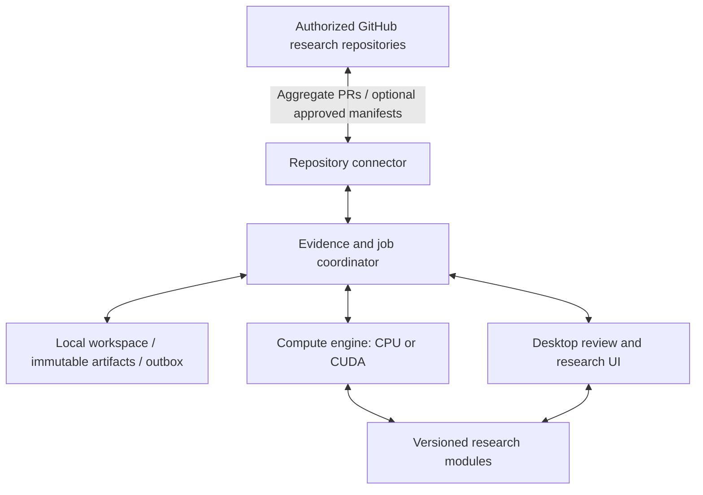

# Voynich Research Studio (VRS) — Product and engineering roadmap

**Proposed product name:** Voynich Research Studio (VRS) — Explore. Reproduce. Validate.
**Date:** 2026-11-25 | **Owner-directed planning revision** | **Baseline:** v0.8.1 / PR #93, head `cd1455caa0de793a0b5cbffdb609098cd908482e`.
**Status:** planned; no new implementation, release, scientific result, or merge is claimed by this document. Name is a working product decision, not trademark clearance.

## 1. Mission and scope

VRS is the local-first research and independent validation workbench of PROJECT VOYNICH, initially in DJCyberdog/voynich. EXP-0031–0037t supply structural and cross-transcription context; EXP-0038–0038g supply the immediate visual/semantic-anchor problem and EXP-0038g triggered the worker. The glyph pipeline is module 01, not the entire product. Later experiment families can add modules through explicit contracts. Research repositories remain the authorities for preregistration, approved jobs, scientific status and evidence; the application executes, reviews, reproduces and reports. Other repositories may participate only through explicit local authorization and a compatible contract.

Non-goals: autonomous decipherment claims, arbitrary remote code execution, a mandatory LLM, proprietary hosted coordination service, automatic main-branch writes/merges, uncontrolled training, public redistribution of private manuscripts or transcriptions, mandatory NVIDIA hardware, and replacing the project's scientific acceptance process. Do not invent future experiment results or reopen failed gates to improve metrics. K-0001 remains deferred until separately authorized.

### Owner requirement: automation-first, exception-only human interaction

VRS is first an unattended, locally configured manuscript-analysis worker; the UI is a control center and exception reviewer, not a mandatory manual annotation workflow. Its fixed owner-defined scope is manuscript-wide script/non-script detection, glyph segmentation/classification, comparison against loaded transcription inventories and existing transcriptions, controlled exception correction, evidence generation and reporting. After one-time local source/workspace/resource setup and opt-in startup/publication, VRS runs that established pipeline automatically without a GitHub job or per-run approval, selects an available backend, checkpoints and reports policy-approved aggregate evidence as PRs. GitHub is primarily an output/report destination; its existing opt-in job intake is an optional compatibility mechanism, not the normal execution prerequisite. No independent hypothesis generation, new EXP design, scientific roadmap changes, autonomous scope expansion or self-assigned research. A new research method or protocol change requires an explicit owner decision. Stop, pause, resource budgets, offline mode, publication disable and credential revocation remain under local control. No arbitrary remote code, direct main writes or automatic merges.

Routine glyph handling is **exception-only**: candidates passing a frozen, validated recognition/coverage/segmentation acceptance policy proceed without user interaction. Only unknown, low-confidence, out-of-distribution, unsupported inventory, ambiguous/compound segmentation or conflicting candidates requiring a human decision enter the ordinary review inbox. Recognized items are retained in evidence and accessible through optional inspection/history, never forced through the normal review queue. Uncalibrated confidence scores alone cannot certify recognition; until an independently validated acceptance policy exists, abstain conservatively rather than silently claiming certainty. Independent blind reference annotation and preregistered audit samples are separate scientific assignments, clearly identified, not routine recognition review; automated predictions never become their own ground truth.

The durable exception queue carries source/region hashes, candidate geometry, reason and uncertainty, per-convention reference inventory, dependency scope and immutable job/model version. Deduplicate retries without collapsing distinct source occurrences; handle separate reviewer assignments independently. The worker continues all unrelated work while a decision is pending. Dependent stages wait explicitly or report a partial/blocked result with complete denominators, and resume only on an authorized hash-bound decision or new approved revision. No hidden loss of unresolved cases; an empty queue is not proof of recognition accuracy.

A tray/status service runs optionally at user login only with explicit opt-in; headless mode is equally supported. Notifications show count and reason summary, are coalesced, respect cooldown/quiet hours and open directly to the next unresolved case. Do not steal focus or interrupt for successfully recognized glyphs. The normal UI may remain closed during processing. Auto-discover newly produced local review batches and approved transferred bundles within configured workspaces only; the prior v0.8.1 manually registered tray mode remains available. On user action, autosave atomically, advance to the next exception, and immediately make the decision available to the local coordinator/outbox. Offline decisions queue for authorized synchronization. Reviewer can map EVA/STA1/other catalogs separately, mark absent/unknown/false positive/compound/deferred, or propose revised boxes. No blind review label leakage.

Human corrections may form versioned candidate training data only under explicit approved training and promotion rules (frozen train/holdout isolation, independent evaluation, provenance and rollback). Never automatically retrain on held-out annotations, propagate a label across a visual cluster, overwrite raw predictions or promote a model simply because the queue was cleared. Report recognized/abstained/reviewed/deferred/failed counts and denominators, model and policy versions, and pending dependencies separately. Auto-reporting is aggregate-only under repository policy; private reviewer content and raw crops remain private unless separately authorized. A completed technical run remains UNADJUDICATED until scientific gate evaluation.

## 2. Baseline to preserve (not a request to redo old releases)

| Release | Existing scope | Evidence / boundary |
|---|---|---|
| 0.1.0 | CPU/CUDA worker, crop preparation, annotation, training, checkpoint | [README](README.md); local prototype |
| 0.2.0 | Offline job pipeline and queue | [PIPELINE](PIPELINE.md) |
| 0.3.0 | Opt-in GitHub bridge, hash-approved jobs, aggregate result PRs | [BRIDGE](BRIDGE.md); single repo; fake API tests only |
| 0.4.0 | Multiscale region proposals | [REGIONS](REGIONS.md) |
| 0.5.0 | Glyph boxes, prototype classifier, unknown abstention | [GLYPHS](GLYPHS.md) |
| 0.5.1 | Multi-convention review, reference/absence/uncertainty/false positives | [ACTIVE_REVIEW](ACTIVE_REVIEW.md) |
| 0.6.0 | Private authentic-reference imports, native IVTFF alignment, grouping | [REFERENCES](REFERENCES.md), [ALIGNMENT](ALIGNMENT.md) |
| 0.7.0 | Local end-to-end validation and physical-leaf holdout | [VALIDATION](VALIDATION.md) |
| 0.8.0 | Focused dark glyph review, revisions and correction proposals | [REVIEW_CLIENT](REVIEW_CLIENT.md) |
| 0.8.1 | Optional Windows tray with explicit batch registration | [TRAY](TRAY.md) |

PR #93 reports **61/61 Linux CPU/Xvfb tests**; this is historical reported evidence, not a new replay. Actual native Windows, tray notifications, RTX/CUDA and live GitHub API are unaccepted. Real-manuscript recognition, independent annotations, mapping, calibration and semantic validation remain scientifically unaccepted/BLOCKED. EXP-0038g stays NOT_MET (59/74, gate requires 60); 16/74 shifted positives are not certified blank. Do not relabel an engineering test as manuscript recognition. Original APIs, immutable historical outputs, review decisions, source hashes, seeds and scientific gates must be preserved. Refactor incrementally behind adapters; no blanket rewrite or repeated completion of v0.1–v0.8.1. Keep the old CLI/Tk client as a fallback until migration and regression gates pass.

## 3. Architecture and trust boundaries



- **Research Core:** job schemas, capability routing, frozen experiment settings, module registry, lifecycle and deterministic accounting. Modules declare ID/version, job types, schemas, required capabilities, permissions, evidence policy, tests, and compatibility. Initially built-in, allowlisted modules only; never import executable code from remote jobs. Explicit local installation/review for new modules.
- **Compute Engine:** retain Python scientific code; CPU is a supported backend, CUDA optional. Explicit backend and actual probe; auto selects only available validated capabilities before a run; no silent restart on another backend after a failure. Resource budgets, bounded queues, cancellation/checkpoint where supported, no UI-thread computation. Additional AMD/DirectML/ROCm routes are optional feasibility work, not promised hardware support.
- **Review Client:** no PyTorch/CUDA requirement; local image decode, private reference catalogs and review package adapters. No direct dependency on the training process. Read-only viewer when appropriate; revisions append-only with atomic autosave, stale-write protection and explicit adjudication. Independent reviewers receive blinded packages, not each other's labels or owner key.
- **Evidence Manager:** content-addressed hashes, frozen source/commit/job/module/plan identifiers, stage receipts, exact denominators/exclusions/abstentions, versioned schemas and replay. Separate technical state (queued/running/completed/failed/cancelled), scientific status (PASS/NOT_MET/BLOCKED/UNADJUDICATED) and sync state. Never automatically promote a completed job to PASS.
- **Repository Connector:** extend v0.3 bridge, not replace it without parity. Per-repo trust policy and credentials, immutable commit-pinned approval index, local action/input allowlist, default deny, TLS, bounded fetches, no redirects or arbitrary URLs/paths/shell. Private workspace and credential store separated from Git. No automatic publication without explicit configured consent. Read-only onboarding, explicit destination/visibility preview, aggregate PR output, no auto merge. Cross-repo routing must never leak artifacts or credentials.
- **Transport:** GitHub for approved job manifests, aggregate evidence and receipts; large/private crops, images, labels, source files and model weights stay in private local storage. Offline review bundles with hashes and access controls can be moved explicitly (e.g. encrypted local transfer); GitHub is not a private file relay by default. Shared review work requires compatible authorized source access and hashes. Optional authenticated LAN transfer is deferred, not a requirement for 1.0. No always-on desktop needed to review a previously delivered bundle.
- **Execution modes:** Review-only (light notebook), Compute-only (headless workstation), Combined (single PC), Independent reproduction (another authorized researcher). Profiles may coexist with separate workspaces. A completed remote job receipt does not prove an independent human review.

### Contract and scientific integrity

Locally scheduled run identity binds fixed scope, source and protocol/module version; reporting also binds authorized target repository and relevant pinned research commit. Optional remote job identity = repository identity + pinned commit + immutable job ID + job digest + protocol/module version; run identity adds frozen input, split, model and parameter digests and reviewer/run identity. New inputs or changed settings require a new registered job/revision. Distinguish independent replica runs from duplicate retries. Local durable journal and outbox support idempotent publication with deterministic branches and exact byte/diff verification; collisions and unknown schema versions fail closed. GitHub is not a distributed lock: duplicate independent runs may be valid; do not claim exactly-once computation. Any optional assignment/lease mechanism needs explicit expiry, reconciliation and tested conflict handling.

Evidence envelope contains repository, commit and experiment IDs, job and run IDs, schema/module/app versions, source/manifest/reference/split hashes, backend and dependency versions, seeds/settings, environment capability summary (not personal identifiers), timings and resource measurements, result counts with fixed denominators, exclusions/abstention, technical/scientific statuses and limitations, artifact hashes, review provenance and replay instructions. Export only fields explicitly allowed per repository; private identities/payloads stay local unless separately authorized. Blind reviewer independence is a scientific process, not established by different account names. Compare CPU/GPU with preregistered numerical tolerances; preserve exact bytes where determinism is expected, never promise cross-hardware bit identity for floating-point training. No threshold adjustment on exposed holdouts.

## 4. Product experience — premium, modern, lightweight

**Direction:** research-oriented desktop workbench, not a dashboard full of decorative metrics. Modern neutral surfaces, dark and light themes, restrained cool accent, semantic colors with text/icons, high-quality typography, consistent spacing, subtle motion (respect reduced motion), crisp HiDPI images and docking/resizable panes. German and English from the start via string resources; Unicode and native glyph/reference rendering. No branding claim or fabricated glyph assets.

**Proposed technical decision:** evaluate Qt 6 / PySide6 (Qt Widgets or Qt Quick where appropriate) for the new shell with a lean CPU-only install and native Windows integration; compare a small prototype against a maintained alternative before committing. No browser engine/GPU requirement for routine review, software-rendered fallback, avoid bundling ML in Review-only. Preserve Tk/CLI during migration. Select the stack on startup/RAM/rendering/accessibility measurements and licensing/distribution review, not appearance alone.

### Information architecture

| Workspace | User experience |
|---|---|
| Home | Background worker status, outstanding exception count, active jobs, repo/sync status, blockers and one-click review; no interaction required when there are no exceptions. No fake decipherment progress. |
| Research / Experiments | Filter by repository, EXP ID, hypothesis, evidence status; pin commit and open preregistration, inspect inputs and run/replicate after explicit validation. |
| Review | Exception-only inbox by default; no routine display of accepted glyphs; keyboard-first queue, source context, candidate crop with zoom/pan, EVA/STA1 side-by-side reference panels, optional other conventions; distinguish unknown, absent from catalog, false positive, compound/segmentation, deferred. |
| Sources & References | Import and verify private PDFs/transcriptions/reference catalogs, provenance, coverage, visual variants, version and checksums. |
| Jobs & Compute | Live actual progress by stage, backend, memory/VRAM, ETA only when measured, pause/cancel/checkpoint if supported, logs on demand; no misleading completed state. |
| Evidence & Validation | Compare independent runs, fixed denominators, confusion matrices, uncertainty, disagreements, gate evidence; open raw local evidence, preview aggregate report and reproduce from pinned inputs. |
| Repositories & Sync | Explicit trust/permissions, current commit, approvals, offline outbox, PR link and remote receipt; diff preview and clear retry/error states. |
| Settings & Diagnostics | Role/profile, workspace, hardware probe, accessibility/language, cache/quota, privacy, credentials, support bundle with redaction, optional tray. |

### Focused glyph workspace

```text
┌ Repository / EXP / module ───────── Search / commands ─ Sync status ┐
│ Navigation │ Queue + filters │ Manuscript context │ Reference panes │
│ Home       │ unresolved      │ zoom / pan / box   │ EVA  │ STA1    │
│ Research   │ deferred        │ enlarged glyph     │ search / zoom  │
│ Review     │ conflicts       │ original / proposal│ other schemes  │
│ Sources    │ reviewed        │ provenance drawer  │ variants       │
│ Jobs       │                 │                   │                │
│ Evidence   │                 │                   │                │
├────────────┴─────────────────┴───────────────────┴────────────────┤
│ False positive · Compound · Unknown · Absent · Defer · Save & next│
│ Actual progress · Autosave state · Undo/revisions · Keyboard hints │
└────────────────────────────────────────────────────────────────────┘
```

The reviewer can select native glyph images/codes independently per convention; absence applies only to loaded inventory/coverage. Keep uncertainty and reference alternatives explicit. Original crop/box never overwritten by a correction. Similarity grouping may reorder, never propagate a decision without review. Hide model predictions and previous reviewer answers in blind mode. Optional advanced context appears on demand. Preserve keyboard shortcuts where possible; support command palette, discoverable shortcuts, search, undo via revision, clear focus rings and screen-reader labels. Use non-color status cues, WCAG 2.2 AA contrast as a design target, keyboard-only operation and scalable text. Responsive layouts at 1280x720, 1366x768 and 1920x1080 with 100–200% scaling: collapsible navigation, queue drawer, stacked/tabs for references on small screens, no inaccessible action buttons. Native tray only if supported and opted in; count-based exception notifications, no forced review or focus stealing. Publication is controlled by the coordinator's explicit repository policy, not the tray.

### Hardware-neutral minimum requirements, adaptive scaling and acceptance budgets

Owner clarification, 2026-11-25: no mandatory optimization for any particular owner PC, notebook, CPU, GPU or RAM configuration. Define sensible product-wide minimum requirements and let faster supported systems benefit from their resources. A machine below the measured minimum is unsupported, not a release blocker. Owner hardware may serve as optional test equipment only.

Provisional engineering targets (not certified requirements until measured on actual representative systems):

| Component | Review-only | Compute-only / Combined |
|---|---|---|
| CPU minimum | x64, 4 physical cores | x64, 4 physical cores / 8 logical threads, AVX2 |
| CPU recommended | 6 cores | 8–16 or more physical cores |
| System RAM minimum / recommended | 8 / 16 GiB | 16 / 32–64+ GiB |
| GPU | No dedicated GPU or ML runtime required | CPU backend supported without GPU; optional compatible CUDA GPU with an initial 8 GiB VRAM target minimum, 16+ GiB recommended |
| Storage | SSD, initial 10 GB free floor | SSD/NVMe, initial 50 GB free floor; workspace-specific estimate may require substantially more |
| OS target | Windows 11 x64 | Windows 11 x64 and Linux x64 |
| Display | 1280x720 minimum target | Headless supported; 1920x1080 recommended for GUI |

Minimum CPU/GPU ISA and driver/runtime support must follow the actual selected dependency builds and verified capability probes, not model-name matching or a VRAM number alone. GPU support is conditional on successful compute, allocation and representative workload tests. AMD/Intel GPU backends are optional future feasibility work; CPU mode is not contingent on vendor hardware. Review-only remains installable without Torch/CUDA. Native Linux review UI is a regression target, not a certified distribution until tested. Storage floors are planning targets, not claims of maximum workspace consumption; estimate inputs, artifacts, cache, checkpoints and free-space reserve before starting. Unsupported or insufficient systems get actionable diagnostics rather than silent failure.

**Adaptive resource scaling (required):**
- Detect physical/logical CPU cores, available RAM, GPU backend capabilities, allocatable VRAM, available storage and relevant OS limits. Probe actual backend execution, not merely device enumeration. Do not identify a performance profile by CPU/GPU marketing name.
- Plan CPU worker count, inference batch size, prefetch depth, I/O concurrency and cache size from measured headroom, representative warm-up probes and user-configurable CPU/RAM/VRAM/storage ceilings. Leave configurable OS/UI headroom; use bounded queues and backpressure, respect resource limits. Avoid oversubscription by nested Torch/BLAS/process pools. Support quiet/balanced/performance presets and explicit advanced overrides constrained by validated resource budgets.
- Use larger resources when beneficial (not simply because present); benchmark single-worker vs parallel processing and increasing inference batch sizes, report actual throughput, memory peaks and bottlenecks. Multiple supported GPUs may process independent shards/runs only after safe device isolation and deterministic result assembly are implemented and tested; multi-GPU is an expansion capability, not a minimum requirement. No artificial cap tied to any owner's hardware.
- Under memory pressure, reduce eligible operational concurrency, pause/checkpoint at a safe boundary or fail clearly. A backend change after a failure requires an explicit new run/revision under the existing evidence policy, not a silent restart. No automatic switch in scientific methods, thresholds, precision, effective training batch, seed, sampling, dataset membership or holdout. Only vary operational parameters when semantic equivalence or preregistered numerical tolerances are established; otherwise record a distinct configuration and run identity. Log effective resources, backend, runtime and any throttling. Never label speedup as scientific improvement.
- Benchmark at least a representative minimum review system, minimum CPU compute profile, validated CUDA profile and a higher-capacity performance profile where actual hardware is available. Compare same pinned workloads and report wall time, throughput, peak RAM/VRAM, UI responsiveness and output equivalence; no invented measurements or linear scaling promise. Missing hardware evidence = BLOCKED for that specific compatibility/scaling claim, not a blanket requirement to test any particular owner's machine.

Review UI target on minimum supported hardware: SSD cold start <= 5 s, steady idle RSS <= 500 MiB, cached next glyph p95 <= 200 ms, responsive 1280x720 layout and no routine swapping. Engineering targets only; benchmark with documented data sizes, cache conditions and actual hardware. Revise minimums or optimize against evidence before stable release. The same scientific and privacy gates apply across every profile.

## 5. Delivery roadmap

Version numbers are semantic major.minor.patch, not decimals: 0.10.0 follows 0.9.x, 0.99.14 is valid. No fixed 0.9.x limit or release-date promise. Increment patch for compatible fixes; minor for backward-compatible capabilities; pre-1.0 breaking changes require documented migration and compatibility window. Stable 1.0 only after technical release gates; research acceptance remains separate.

Priority: S = release/security/scientific-integrity critical; A = core experience; B = expansion; C = optional polish. All entries below **PLANNED**, unless a later evidence-backed change says otherwise. A milestone is not done by documenting a plan.

| Version / ID | Priority | Deliverable | Acceptance evidence |
|---|---|---|---|
| 0.9.0 / VRS-090 | S | Baseline freeze, dependency/import graph, existing bridge and review contracts, supported install profiles | Pin PR #93; reproduce existing suite with explicit private-fixture skips; inventory schemas and hashes; golden fixtures |
| 0.9.1 / VRS-091 | S | Extract stable research/core, compute, review and repository interfaces behind adapters | Old commands and golden outputs preserved; no ML import in Review-only |
| 0.9.2 / VRS-092 | S | Versioned manifests, module capabilities and evidence envelope | Schema validation, unknown-version reject, tamper/path/size tests; migration fixtures |
| 0.9.3 / VRS-093 | S | Local job ledger, locks, cancellation/checkpoints, outbox | Crash/restart, stale lock, retry, duplicate and failed-stage tests; no silent rerun |
| 0.9.4 / VRS-094 | A | Hardware-neutral installation profiles, capability diagnostics and adaptive resource planner | Clean offline review install without Torch; real backend probes, memory/storage preflight, bounded adaptive CPU/VRAM scheduling plan, overrides and explicit fallback policy; synthetic low/high-resource profile tests |
| 0.9.5 / VRS-095 | S | Unattended fixed-scope local coordinator and durable dependency-aware exception lifecycle | Local pipeline replay with UI closed and no GitHub job, optional policy-gated polling, nonblocking pending reviews, restart recovery, pause/stop, no unapproved execution |
| 0.9.6 / VRS-096 | S | Versioned selective-recognition policy and exception router | Frozen policy fixture: accepted candidates never enter routine inbox, unknown/ambiguous/unsupported cases do, conservative abstention without valid calibration, denominator conservation |
| 0.9.7 / VRS-097 | S | Correction handoff and controlled resume | Atomic decisions, immutable originals, exact dependency wakeup, duplicate/stale decision rejection, offline recovery; no automatic model promotion |
| 0.10.0 / VRS-100 | A | UI technology spike, design system, layout prototype, accessibility baseline | Notebook-class profiling, license/dependency decision record, small-window and HiDPI screenshots |
| 0.10.1 / VRS-101 | A | Modern shell, onboarding, project/workspace switcher, Home and Settings | Keyboard navigation, empty/error/offline states, dark/light, DE/EN, persisted layouts |
| 0.10.2 / VRS-102 | A | Focused glyph canvas and uncertainty-first queue | Zoom/pan/box fidelity, lazy loading and keyboard review, no visible owner key in blind mode |
| 0.10.3 / VRS-103 | S | Native reference panels, per-convention decisions, revisions and adjudication UI | EVA/STA1 and additional inventory fixtures, absence/unknown/false-positive/compound distinctions, no silent mapping |
| 0.10.4 / VRS-104 | A | Sources & References, import wizard, provenance and coverage | Pinned source verification, invalid PDF/catalog handling, private assets remain local |
| 0.10.5 / VRS-105 | A | Jobs & Compute, stage progress, logs, resource caps and diagnostics | No UI blocking during load, bounded memory, truthful cancel/resume states, redacted diagnostics |
| 0.10.6 / VRS-106 | A | Experiments and Evidence workspaces, comparison and export preview | Real denominator accounting, failed/blocked visibility, provenance drill-down; no fake accuracy |
| 0.10.7 / VRS-107 | A | Tray and notifications, accessibility/UX polish, review productivity | Native Windows tray, opted-in auto-discovery and startup, coalesced exception notifications, no tray-initiated upload, keyboard-only completion, high-DPI and responsiveness tests |
| 0.11.0 / VRS-110 | S | Generalize existing GitHub bridge behind repository profiles | Legacy allowlist parity, per-repo credential isolation, read-only setup, unauthorized repo rejects |
| 0.11.1 / VRS-111 | S | Commit-pinned approved job intake and capability routing | Revoked/stale job, malformed payload, commit mismatch, untrusted URLs/path traversal tests |
| 0.11.2 / VRS-112 | S | Aggregate evidence PR publication and receipt reconciliation | Exact byte/diff verification, configured consent, automatic outbox publication without per-job clicks, deterministic retry, branch collision/PR failure tests |
| 0.11.3 / VRS-113 | S | Multi-repo and fork/contributor workflow; explicit export policy | Two isolated test repositories, credential/visibility negative tests, no direct main writes or auto merge |
| 0.11.4 / VRS-114 | S | Offline sync, private review-bundle import/export and conflict resolution | Interrupted transfer, digest mismatch, stale revision, idempotent retry and unauthorized data export rejected |
| 0.11.5 / VRS-115 | S | Independent worker/reviewer identities and blinded assignments | Separate workspaces, duplicate vs replica accounting, sealed reviews and adjudication; human independence still curator-controlled |
| 0.11.6 / VRS-116 | S | Live GitHub integration acceptance | Owner-authorized sandbox test repositories, actual read/publish PR and receipt; no production secrets/data |
| 0.12.0 / VRS-120 | S | Module 01: wrap glyph pipeline as a first-class research module | Golden parity for segmentation, classifiers, review, alignment and validation; preserve v0.7 denominators |
| 0.12.1 / VRS-121 | S | Independent cohort builder and source/physical-leaf verification workflow | Frozen provenance splits, overlap/duplicate controls, exclusion reporting, blind annotation handoff |
| 0.12.2 / VRS-122 | S | Reproduction runner and CPU/CUDA comparison | Actual hardware logs, frozen settings, declared numerical tolerances, exact deterministic artifacts when applicable |
| 0.12.3 / VRS-123 | A | Module 02: approved structural/statistical experiment adapter pilot | Select one explicitly approved EXP-0031–0037 family replay; no invented generality; compare to pinned legacy evidence |
| 0.12.4 / VRS-124 | A | Module authoring SDK, sample module, docs and compatibility matrix | Explicitly installed sample module, schema version rejection and independent tests, no remote executable plugins |
| 0.12.5 / VRS-125 | B | Additional visual/semantic anchor review adapter | Only after protocol/owner authorization; freeze mapping and controls, no inferred semantic claim |
| 0.12.6 / VRS-126 | S | Controlled learning from reviewed exceptions and selective-risk evaluation | Frozen independent holdout, calibration/coverage and selective risk, approved training and model promotion, rollback; no leakage or self-label confirmation |
| 0.13.0 / VRS-130 | S | Windows x64 distribution, Review-only portable package, optional separate compute dependencies | Clean VM/install/uninstall, dependency locks, checksums, reproducible build procedure, no bundled private data |
| 0.13.1 / VRS-131 | S | Security/privacy hardening, credential store, artifact quotas and threat model | Secret redaction, malicious manifest, archive traversal, symlink, zip-bomb, unsafe checkpoint and cross-repo leak tests |
| 0.13.2 / VRS-132 | S | Native Windows minimum-profile acceptance and benchmark | Representative supported minimum review and CPU compute hardware; tray, small display, measured RAM/CPU/storage budgets; no owner-specific hardware gate |
| 0.13.3 / VRS-133 | S | Native CUDA and performance-scaling acceptance | Actual supported CUDA hardware, higher-capacity profile where available, training/inference/interrupt-resume smoke, resource/throughput comparison and pinned output equivalence; driver and Torch versions; no synthetic scientific claim |
| 0.13.4 / VRS-134 | A | Usability validation and docs for external researchers | Unassisted import-review-export/reproduction tasks, accessible UI, documented failures and remedies |
| 0.14.0 / VRS-140 | S | Integrated release candidate, migration and rollback | Legacy decision roundtrip, compatibility matrix, full regression, known limitations, no unapproved migrations |
| 0.14.1+ / VRS-141 | S | Release candidate defect remediation as needed | Every blocker closed or explicit owner disposition with evidence; no fixed patch ceiling |
| 1.0.0 / VRS-1000 | S | Stable technical release and owner acceptance | All mandatory release gates below independently evidenced; signed/hashed release artifacts and changelog |

Optional later work (not 1.0 blockers): authenticated LAN/private artifact transport, non-CUDA GPU backend research after hardware feasibility/accuracy benchmarking, additional OS/architecture packages, richer manuscript navigation, controlled external module distribution, optional assistive ML models and more research modules. Separate owner/preregistration approval for new scientific work.

## 6. Release gates and reporting

- G1 compatibility: old CLI, original schemas/reviews and artifacts replay or migrate with verified digest, rollback and no data loss; reported 61 baseline tests rerun plus new regression tests. Private-source-dependent tests report actual run/skip counts.
- G2 isolation: Review-only installs and performs review on representative minimum supported hardware without CUDA/Torch; compute/headless works separately; package tests pass.
- G3 real platform: native Windows review/tray and supported CUDA tested on representative actual hardware, Linux CPU regression. Demonstrate minimum and higher-resource profiles, or mark untested compatibility/scaling claims BLOCKED. No mandatory owner-specific hardware.
- G4 repository workflow: live authorized test repos prove read-only intake, exact evidence PR, receipt, retry, revoke, permissions and cross-repo isolation; no direct main write or auto merge.
- G5 evidence integrity: frozen inputs, hashes, split and reviewer rules, failure/unknown accounting, reproducibility/tolerances, privacy and blind-mode negative tests.
- G6 product quality: UX tasks, keyboard-only and HiDPI, minimum-profile budgets and adaptive resource scaling measured, understandable errors and recovery; actual benchmark results documented.
- G8 autonomous operation: end-to-end locally scheduled fixed-scope analysis without GitHub job intake, compute, exception-only review routing, continued unrelated work, correction/resume and policy-approved result PR with UI closed; actual crash/restart and empty-inbox cases; no silent acceptance of unvalidated glyphs. Separate blind annotation/audit jobs remain available.
- G7 distribution: locked dependencies, build/license review, portable review and compute installation path, hashes, release notes, migration/rollback, owner approval.

**Scientific acceptance is independent:** EXP-0038g NOT_MET remains; obtain independent real-manuscript annotations, physical mapping, certified script/non-script controls and genuinely unexposed holdouts under an approved frozen protocol. Report actual failures and exclusions. VRS 1.0 technical readiness does not imply recognition accuracy, semantics, or decipherment. A scientific gate may remain BLOCKED if human/reference evidence is unavailable; never advertise that capability as validated.

For every milestone: record ID, exact code/test commit, status (PLANNED / IN_PROGRESS / TECH_PASS / NOT_MET / BLOCKED), actual tests and results, artifact digests, hardware/software, remaining limitations, next actionable step. No repeated status-only loops; if blocked, identify smallest missing evidence and move to a genuinely independent unblocked task. Use a scoped PR with change manifest, regression evidence, and owner merge gate. Do not alter hourly research automation by implication. Keep code and research experiments separate and never rewrite existing findings.

## 7. Implementation checkpoint — 2026-11-25

VRS-090 / VRS-091: local technical PASS, full recovered baseline 61/61 and current 71/71 (no skips). VRS-092: fixed local manifest/receipt/evidence contract implemented; 11/11 new tests, 82/82 integrated tests, no skips. See [VRS-091-092.md](VRS-091-092.md). Live CI, native Windows/CUDA, scientific acceptance and coordinator/reporting integration remain separate gates. GitHub is the output destination, not a required input to local execution.

VRS-093: local ledger/outbox API implemented and TECH_PASS, 13/13 new and 95/95 integrated tests, no skips. See [VRS-093.md](VRS-093.md). Actual coordinator and transport integration remain pending. Next: VRS-094 hardware/install profiles and diagnostics, then VRS-095. No automatic publication or new scientific research implied.

## 8. Original starting action (historical)

VRS-090: freeze v0.8.1 interfaces and exact baseline, enumerate imports and existing GitHub bridge policies, rerun available tests, define private-fixture and actual Windows/GPU gaps, and prepare migration adapters. Follow with VRS-091 and the automation/exception milestones VRS-095–097 before UI migration; do not start remote publication or new scientific scoring merely because this roadmap exists.
